# ĐẶC TẢ THIẾT KẾ CƠ SỞ DỮ LIỆU KHÔNG GIAN (SPATIAL DATABASE SPECIFICATION)
## HỆ THỐNG QUẢN LÝ VÀ GIÁM SÁT HÀNH TRÌNH XE BUÝT 2D (WEB GIS)

> **Tài liệu phục vụ Báo cáo Đồ án Hệ thống Thông tin Địa lý (GIS / Web GIS):** Đặc tả chi tiết cấu trúc CSDL không gian, mô hình thực thể quan hệ (ERD), mô tả chi tiết các mối quan hệ nghiệp vụ, từ điển dữ liệu (Data Dictionary), quy ước hệ quy chiếu trắc địa, cơ chế chỉ mục không gian (Spatial Index) và các hàm không gian OGC.

---

## 1. TỔNG QUAN HỆ THỐNG CƠ SỞ DỮ LIỆU KHÔNG GIAN

* **Hệ quản trị CSDL:** MySQL 8.x Spatial / MariaDB Spatial (Storage Engine: `InnoDB` hỗ trợ giao dịch ACID và Spatial Index).
* **Tên CSDL:** `bus_management_db`
* **Bộ mã ký tự (Charset / Collation):** `utf8mb4` / `utf8mb4_unicode_ci` (hỗ trợ tiếng Việt có dấu và ký tự đa ngôn ngữ).
* **Hệ quy chiếu tọa độ không gian (CRS - Coordinate Reference System):** 
  * **WGS84 (World Geodetic System 1984)** - Mã định danh chuẩn: **EPSG:4326** / **SRID 4326**.
  * Quy ước trục trắc địa phẳng: **`axis-order=long-lat`** (Kinh độ `longitude` từ $106.7^\circ - 106.9^\circ\text{ E}$ đứng trước, Vĩ độ `latitude` từ $10.7^\circ - 10.9^\circ\text{ N}$ đứng sau).
* **Chuẩn biểu diễn đối tượng địa lý:** Tuân thủ tiêu chuẩn **OGC SFA (OpenGIS Simple Feature Access)**:
  * Kiểu đối tượng điểm: `POINT(lon lat)` đại diện cho vị trí trạm dừng và vết GPS động của xe.
  * Kiểu đối tượng đường: `LINESTRING(lon1 lat1, lon2 lat2, ...)` đại diện cho quỹ đạo tim đường tuyến xe.
  * Định dạng trao đổi dữ liệu: **GeoJSON (RFC 7946)** thông qua hàm chuẩn hóa `ST_AsGeoJSON()` phục vụ hiển thị trên ArcGIS Maps SDK for JavaScript.

---

## 2. SƠ ĐỒ THỰC THỂ QUAN HỆ KHÔNG GIAN (SPATIAL ERD)

Biểu đồ dưới đây được thiết kế theo bố cục dạng đứng (Portrait Grid: mỗi dòng 2 bảng) nhằm đảm bảo hiển thị cân đối và sắc nét trên trang in báo cáo A4:

```mermaid
flowchart TD
    %% Tùy biến Style giao diện
    classDef tblBody fill:#f8fafc,stroke:#94a3b8,stroke-width:1.5px,text-align:left,font-size:11.5px;
    classDef tblSpatial fill:#f0fdf4,stroke:#16a34a,stroke-width:1.5px,text-align:left,font-size:11.5px;
    classDef tblLog fill:#fef2f2,stroke:#ef4444,stroke-width:1.5px,text-align:left,font-size:11.5px;

    %% ==========================================
    %% DÒNG 1: BUS_ROUTES  &  ROUTE_PATHS
    %% ==========================================
    subgraph ROW1 [" "]
        direction LR
        T_ROUTES["<b>bus_routes</b> (Danh mục Tuyến buýt)<hr/>
        <b>string</b> &nbsp; <b>route_id (PK)</b> : Mã tuyến (1, 3, 4...)<br/>
        <b>string</b> &nbsp; route_number : Số hiệu tuyến (01, 03, 04...)<br/>
        <b>string</b> &nbsp; route_name : Tên lộ trình tuyến buýt<br/>
        <b>float</b> &nbsp;&nbsp;&nbsp; distance_km : Cự ly toàn tuyến (km)<br/>
        <b>int</b> &nbsp;&nbsp;&nbsp;&nbsp;&nbsp; headway_min : Giãn cách chuyến (phút)<br/>
        <b>string</b> &nbsp; route_type, color, operation_time, headway_text"]:::tblBody

        T_PATHS["<b>route_paths</b> (Lộ trình Tim đường GIS)<hr/>
        <b>int</b> &nbsp;&nbsp;&nbsp;&nbsp;&nbsp; <b>path_id (PK)</b> : Mã lộ trình tự tăng<br/>
        <b>string</b> &nbsp; <b>route_id (FK)</b> : Mã tuyến tham chiếu<br/>
        <b>tinyint</b> direction : Chiều chạy (1: Đi, 2: Về)<br/>
        <b>linestr</b> geom : SRID 4326 Spatial (Tim đường)"]:::tblSpatial
    end

    %% ==========================================
    %% DÒNG 2: BUS_STOPS  &  ROUTE_STOPS
    %% ==========================================
    subgraph ROW2 [" "]
        direction LR
        T_STOPS["<b>bus_stops</b> (Trạm dừng xe buýt GIS)<hr/>
        <b>string</b> &nbsp; <b>stop_id (PK)</b> : Mã trạm (1, 2, 3...)<br/>
        <b>string</b> &nbsp; stop_code : Mã trạm nghiệp vụ (Q6 095...)<br/>
        <b>string</b> &nbsp; stop_name : Tên trạm dừng đón/trả<br/>
        <b>string</b> &nbsp; address : Địa chỉ / Tuyến đường<br/>
        <b>string</b> &nbsp; stop_type, status : Loại trạm, trạng thái<br/>
        <b>point</b> &nbsp;&nbsp; geom : SRID 4326 Spatial (Tọa độ trạm)"]:::tblSpatial

        T_ROUTE_STOPS["<b>route_stops</b> (Liên kết Tuyến - Trạm)<hr/>
        <b>string</b> &nbsp; <b>route_id (PK,FK)</b> : Mã tuyến<br/>
        <b>string</b> &nbsp; <b>stop_id (FK)</b> : Mã trạm dừng<br/>
        <b>tinyint</b> <b>direction (PK)</b> : Chiều (1: Đi, 2: Về)<br/>
        <b>int</b> &nbsp;&nbsp;&nbsp;&nbsp;&nbsp; <b>stop_order (PK)</b> : Thứ tự ghé trạm (1, 2, 3...)"]:::tblBody
    end

    %% ==========================================
    %% DÒNG 3: VEHICLES  &  SCHEDULES
    %% ==========================================
    subgraph ROW3 [" "]
        direction LR
        T_VEHICLES["<b>vehicles</b> (Đội ngũ Phương tiện)<hr/>
        <b>string</b> &nbsp; <b>vehicle_id (PK)</b> : Mã định danh xe<br/>
        <b>string</b> &nbsp; <b>plate_number (UK)</b> : Biển số kiểm soát<br/>
        <b>int</b> &nbsp;&nbsp;&nbsp;&nbsp;&nbsp; capacity : Sức chứa hành khách (chỗ)<br/>
        <b>string</b> &nbsp; driver_name : Họ tên tài xế phụ trách<br/>
        <b>string</b> &nbsp; status : ACTIVE | MAINTENANCE | INACTIVE"]:::tblBody

        T_SCHEDULES["<b>schedules</b> (Lịch trình Phân công chuyến)<hr/>
        <b>int</b> &nbsp;&nbsp;&nbsp;&nbsp;&nbsp; <b>schedule_id (PK)</b> : Mã phân công tự tăng<br/>
        <b>string</b> &nbsp; <b>route_id (FK)</b> : Tuyến phân công<br/>
        <b>string</b> &nbsp; <b>vehicle_id (FK)</b> : Xe được điều động<br/>
        <b>time</b> &nbsp;&nbsp;&nbsp; departure_time : Giờ xuất bến kế hoạch<br/>
        <b>tinyint</b> direction : Chiều chạy (1: Đi, 2: Về)"]:::tblBody
    end

    %% ==========================================
    %% DÒNG 4: VEHICLE_TRACKING_LOGS  &  USERS
    %% ==========================================
    subgraph ROW4 [" "]
        direction LR
        T_LOGS["<b>vehicle_tracking_logs</b> (Nhật ký Vết GPS)<hr/>
        <b>bigint</b> &nbsp; <b>log_id (PK)</b> : Mã bản ghi nhật ký vết<br/>
        <b>string</b> &nbsp; <b>vehicle_id (FK)</b> : Mã xe phát tín hiệu<br/>
        <b>float</b> &nbsp;&nbsp;&nbsp; speed_kmh : Vận tốc tức thời (km/h)<br/>
        <b>float</b> &nbsp;&nbsp;&nbsp; heading : Góc phương vị đầu xe (0-360°)<br/>
        <b>point</b> &nbsp;&nbsp; geom : SRID 4326 Spatial (Tọa độ GPS)<br/>
        <b>timest</b> recorded_at : Thời điểm nhận tín hiệu"]:::tblLog

        T_USERS["<b>users</b> (Quản trị & Phân quyền RBAC)<hr/>
        <b>int</b> &nbsp;&nbsp;&nbsp;&nbsp;&nbsp; <b>user_id (PK)</b> : Mã tài khoản tự tăng<br/>
        <b>string</b> &nbsp; <b>username (UK)</b> : Tên đăng nhập duy nhất<br/>
        <b>string</b> &nbsp; password_hash : Mật khẩu mã hóa Bcrypt<br/>
        <b>string</b> &nbsp; full_name : Họ và tên cán bộ điều hành<br/>
        <b>string</b> &nbsp; email : Email liên hệ<br/>
        <b>enum</b> &nbsp;&nbsp;&nbsp; role : ADMIN | MANAGER | VIEWER<br/>
        <b>timest</b> created_at : Thời điểm tạo tài khoản"]:::tblBody
    end

    %% ==========================================
    %% CÁC ĐƯỜNG LIÊN KẾT QUAN HỆ (RELATIONSHIPS)
    %% ==========================================
    T_ROUTES -->|1 : N| T_PATHS
    T_ROUTES -->|1 : N| T_ROUTE_STOPS
    T_STOPS -->|1 : N| T_ROUTE_STOPS

    T_ROUTES -->|1 : N| T_SCHEDULES
    T_VEHICLES -->|1 : N| T_SCHEDULES
    T_VEHICLES -->|1 : N| T_LOGS

    %% Ẩn khung bao để tạo 4 dòng bảng tự nhiên
    style ROW1 fill:none,stroke:none;
    style ROW2 fill:none,stroke:none;
    style ROW3 fill:none,stroke:none;
    style ROW4 fill:none,stroke:none;
```



---

## 2.1. MÔ TẢ CHI TIẾT CÁC MỐI QUAN HỆ TRONG SƠ ĐỒ THỰC THỂ QUAN HỆ

Hệ thống cơ sở dữ liệu của đề tài được thiết kế chuẩn hóa theo dạng chuẩn 3 (3NF) kết hợp mở rộng các kiểu dữ liệu không gian OGC. Mối liên kết giữa các thực thể thuộc tính và thực thể không gian được phân chia thành **5 nhóm quan hệ nghiệp vụ cốt lõi** như sau:

### 1. Quan hệ giữa Tuyến xe buýt và Lộ trình Tim đường (`bus_routes` – `route_paths`): Quan hệ $1 - N$
* **Bản chất nghiệp vụ:** Mỗi một tuyến xe buýt (`bus_routes`) trong thực tế vận hành có ít nhất hai hướng di chuyển độc lập: *Lượt đi (Outbound - Direction 1)* và *Lượt về (Inbound - Direction 2)* với quỹ đạo tim đường số hóa khác nhau do cấu trúc đường một chiều hoặc luồng phân làn giao thông đô thị.
* **Cơ chế liên kết khóa:** Trường `route_id` trong bảng `route_paths` đóng vai trò là Khóa ngoại (Foreign Key) tham chiếu trực tiếp đến Khóa chính `route_id` của bảng `bus_routes`.
* **Ràng buộc toàn vẹn:** Thiết lập quy tắc **`ON DELETE CASCADE`** và **`ON UPDATE CASCADE`**. Khi một tuyến xe bị xóa hoặc điều chỉnh mã định danh trong hệ thống, toàn bộ các đối tượng hình học tim đường (`LINESTRING`) thuộc tuyến đó sẽ tự động được xóa/cập nhật đồng bộ, tránh phát sinh dữ liệu mồ côi (orphan records).

### 2. Quan hệ giữa Tuyến xe buýt và Trạm dừng đón/trả (`bus_routes` – `bus_stops`): Quan hệ $M - N$ thông qua bảng `route_stops`
* **Bản chất nghiệp vụ:**
  * Một tuyến xe buýt đi qua và dừng đón/trả khách tại nhiều trạm dừng khác nhau trong hành trình ($1 \text{ Tuyến} \rightarrow N \text{ Trạm}$).
  * Ngược lại, một trạm dừng (ví dụ: *Trạm Thư viện Trung tâm ĐHQG*) có vị trí cố định nhưng đóng vai trò là điểm trung chuyển phục vụ cho nhiều tuyến xe buýt khác nhau cùng khai thác ($1 \text{ Trạm} \rightarrow N \text{ Tuyến}$).
* **Giải pháp chuẩn hóa:** Sử dụng bảng liên kết trung gian **`route_stops`** để tách quan hệ Nhiều – Nhiều ($M - N$) thành hai quan hệ Một – Nhiều ($1 - N$):
  * `bus_routes` $\xrightarrow{1 : N}$ `route_stops` (thông qua khóa ngoại `route_id`).
  * `bus_stops` $\xrightarrow{1 : N}$ `route_stops` (thông qua khóa ngoại `stop_id`).
* **Thuộc tính quan hệ:** Khóa chính tổng hợp bao gồm bộ ba `(route_id, direction, stop_order)`: mỗi vị trí ghé trên một chiều tuyến là duy nhất, cho phép tuyến vòng ghé cùng một trạm nhiều lần (ví dụ trạm đầu = trạm cuối). `stop_id` được đánh chỉ mục riêng để tra các tuyến đi qua một trạm. Đồng thời, trường thuộc tính **`stop_order`** ($1, 2, 3, \dots, n$) quy định thứ tự ghé trạm tuần tự, giúp hệ thống dựng được chuỗi lộ trình đón khách chính xác trên bản đồ.

### 3. Quan hệ Điều phối Lịch trình Chuyến xe (`bus_routes` – `vehicles` – `schedules`): Quan hệ $1 - N$ đa diện
* **Bản chất nghiệp vụ:** Biểu đồ lịch trình (`schedules`) là thực thể giao tác liên kết giữa Tuyến đường khai thác và Phương tiện vận tải:
  * Một tuyến xe buýt trong ngày sẽ có nhiều khung giờ xuất bến khác nhau ($1 \text{ Tuyến} \rightarrow N \text{ Lịch trình}$).
  * Một phương tiện xe buýt có thể được điều động quay vòng để chạy nhiều chuyến xe trong các khung giờ khác nhau ($1 \text{ Xe} \rightarrow N \text{ Lịch trình}$).
* **Cơ chế liên kết khóa:** Bảng `schedules` chứa hai khóa ngoại:
  * `route_id` tham chiếu đến `bus_routes(route_id)`.
  * `vehicle_id` tham chiếu đến `vehicles(vehicle_id)`.
* **Ý nghĩa:** Cho phép hệ thống truy vấn và hiển thị tức thời biểu đồ phân công xe chạy theo giờ xuất bến (`departure_time`) và chiều chạy (`direction`), hỗ trợ quản lý biểu đồ giờ và phát hiện xung đột lịch trình.

### 4. Quan hệ Giám sát Hành trình Vết xe thời gian thực (`vehicles` – `vehicle_tracking_logs`): Quan hệ $1 - N$ (Chuỗi thời gian Spatio-Temporal)
* **Bản chất nghiệp vụ:** Trong suốt quá trình xe buýt lăn bánh, thiết bị định vị GPS/bộ giả lập viễn thông sẽ định kỳ phát tín hiệu tọa độ về máy chủ mỗi $1 - 2\text{ giây}$. Do đó, một phương tiện xe buýt (`vehicles`) sẽ tích lũy một tập hợp vô số các bản ghi vết di chuyển theo thời gian trong bảng `vehicle_tracking_logs` ($1 \text{ Xe} \rightarrow N \text{ Bản ghi GPS}$).
* **Cơ chế liên kết khóa:** Trường `vehicle_id` trong bảng nhật ký đóng vai trò là Khóa ngoại liên kết chặt chẽ với bảng `vehicles`.
* **Tối ưu hóa truy vấn:** Bảng nhật ký vết được đánh chỉ mục kết hợp **`INDEX(vehicle_id, recorded_at)`** và **`SPATIAL INDEX(geom)`**. Cấu trúc này cho phép máy chủ lọc cực nhanh lịch sử tọa độ của một xe cụ thể theo khoảng thời gian tùy chọn để tái hiện vệt hành trình (Playback History) trên bản đồ 2D mà không gây quá tải CSDL.

### 5. Thực thể Độc lập Quản trị Người dùng và Phân quyền (`users`)
* **Bản chất nghiệp vụ:** Bảng `users` quản lý danh mục tài khoản cán bộ quản trị và nhân viên điều hành hệ thống theo mô hình phân quyền **RBAC (Role-Based Access Control)**.
* **Đặc tính liên kết:** Bảng `users` tồn tại độc lập, không thiết lập khóa ngoại trực tiếp tới các bảng dữ liệu không gian nhằm đảm bảo tính toàn vẹn cấu trúc và hiệu năng hệ thống. Mọi tương tác chỉnh sửa dữ liệu bản đồ hay xuất nhập JSON đều được kiểm soát qua tầng trung gian xác thực **JWT (JSON Web Token)** trước khi tác động vào CSDL.

### 📊 Bảng tổng hợp Ma trận Quan hệ và Ràng buộc Toàn vẹn (Integrity Matrix)

| Bảng Cha (Parent Table) | Bảng Con (Child Table) | Khóa Ngoại (Foreign Key) | Loại Quan Hệ | Hành Vi Ràng Buộc (CASCADE / RESTRICT) |
|---|---|---|:---:|---|
| `bus_routes` | `route_paths` | `route_id` | $1 - N$ | `ON DELETE CASCADE`, `ON UPDATE CASCADE` |
| `bus_routes` | `route_stops` | `route_id` | $1 - N$ | `ON DELETE CASCADE`, `ON UPDATE CASCADE` |
| `bus_stops` | `route_stops` | `stop_id` | $1 - N$ | `ON DELETE CASCADE`, `ON UPDATE CASCADE` |
| `bus_routes` | `schedules` | `route_id` | $1 - N$ | `ON DELETE CASCADE`, `ON UPDATE CASCADE` |
| `vehicles` | `schedules` | `vehicle_id` | $1 - N$ | `ON DELETE CASCADE`, `ON UPDATE CASCADE` |
| `vehicles` | `vehicle_tracking_logs` | `vehicle_id` | $1 - N$ | `ON DELETE CASCADE`, `ON UPDATE CASCADE` |

---

## 3. TỪ ĐIỂN DỮ LIỆU CHI TIẾT (DATA DICTIONARY)

### 3.1. Bảng `users` (Người dùng & Phân quyền Quản trị)
* **Ý nghĩa:** Quản lý tài khoản đăng nhập vào Cổng Quản trị (Admin Portal), phân cấp quyền truy cập hệ thống theo mô hình RBAC (Role-Based Access Control).

| Tên trường | Kiểu dữ liệu | Ràng buộc | Giá trị mặc định | Giải thích nghiệp vụ |
|---|---|---|---|---|
| `user_id` | `INT` | `PK, AUTO_INCREMENT` | Tự tăng | Mã định danh duy nhất của người dùng |
| `username` | `VARCHAR(50)` | `NOT NULL, UNIQUE` | Không | Tên tài khoản đăng nhập hệ thống |
| `password_hash` | `VARCHAR(255)` | `NOT NULL` | Không | Mật khẩu băm an toàn qua thuật toán **Bcrypt (Cost factor = 10)** |
| `full_name` | `VARCHAR(100)` | `NOT NULL` | Không | Họ và tên đầy đủ của cán bộ điều hành |
| `email` | `VARCHAR(100)` | `NULL` | `""` | Địa chỉ thư điện tử liên hệ |
| `role` | `ENUM` | `NOT NULL` | `'MANAGER'` | Vai trò: `ADMIN` (Toàn quyền), `MANAGER` (Quản lý dữ liệu), `VIEWER` (Chỉ xem) |
| `created_at` | `TIMESTAMP` | `NOT NULL` | `CURRENT_TIMESTAMP` | Thời điểm khởi tạo tài khoản |

---

### 3.2. Bảng `bus_routes` (Thực thể Thuộc tính Tuyến xe buýt)
* **Ý nghĩa:** Lưu trữ thông tin thuộc tính phi không gian của mạng lưới các tuyến xe buýt trong khu vực quản lý.

| Tên trường | Kiểu dữ liệu | Ràng buộc | Giá trị mặc định | Giải thích nghiệp vụ |
|---|---|---|---|---|
| `route_id` | `VARCHAR(20)` | `PRIMARY KEY` | Không | Mã định danh tuyến (ví dụ: `1`, `3`, `4`) |
| `route_number` | `VARCHAR(10)` | `NOT NULL` | Không | Số hiệu nhận diện tuyến (ví dụ: `01`, `03`, `100`) |
| `route_name` | `VARCHAR(150)` | `NOT NULL` | Không | Tên đầy đủ lộ trình (ví dụ: `Ga Ba Son - Bến xe buýt Chợ Lớn`) |
| `distance_km` | `FLOAT` | `NULL` | `0.0` | Tổng chiều dài cự ly tuyến tính bằng kilômét |
| `headway_min` | `INT` | `NULL` | `15` | Thời gian giãn cách giữa 2 chuyến liên tiếp (phút) |
| `route_type` | `VARCHAR(60)` | `NULL` | `NULL` | Loại tuyến (ví dụ: `Phổ thông - Có trợ giá`) |
| `color` | `VARCHAR(9)` | `NULL` | `NULL` | Màu hiển thị tuyến trên bản đồ (`#RRGGBB`) |
| `operation_time` | `VARCHAR(30)` | `NULL` | `NULL` | Giờ hoạt động (ví dụ: `05:00 - 22:00`) |
| `headway_text` | `VARCHAR(20)` | `NULL` | `NULL` | Giãn cách chuyến dạng khoảng (ví dụ: `8 - 20`) |

---

### 3.3. Bảng `route_paths` (Thực thể Không gian Lộ trình Tim đường - LineString)
* **Ý nghĩa:** Lưu trữ hình học không gian (Geometry) của tim đường giao thông mà tuyến buýt đi qua, phân biệt theo chiều Lượt đi và Lượt về.

| Tên trường | Kiểu dữ liệu | Ràng buộc | Giá trị mặc định | Giải thích nghiệp vụ |
|---|---|---|---|---|
| `path_id` | `INT` | `PK, AUTO_INCREMENT` | Tự tăng | Mã định danh đoạn lộ trình tim đường |
| `route_id` | `VARCHAR(20)` | `NOT NULL, FK` | Không | Mã tuyến, liên kết `bus_routes(route_id)` (`ON DELETE CASCADE`) |
| `direction` | `TINYINT` | `NOT NULL` | `1` | Chiều di chuyển: `1` (Lượt đi - Outbound), `2` (Lượt về - Inbound) |
| `geom` | `LINESTRING` | `NOT NULL, SPATIAL` | SRID 4326 | Chuỗi tọa độ các đỉnh uốn tim đường: `LINESTRING(lon1 lat1, lon2 lat2, ...)` |

---

### 3.4. Bảng `bus_stops` (Thực thể Không gian Trạm dừng xe buýt - Point)
* **Ý nghĩa:** Quản lý cơ sở hạ tầng các điểm dừng đón/trả khách cố định trên toàn mạng lưới Web GIS.

| Tên trường | Kiểu dữ liệu | Ràng buộc | Giá trị mặc định | Giải thích nghiệp vụ |
|---|---|---|---|---|
| `stop_id` | `VARCHAR(20)` | `PRIMARY KEY` | Không | Mã định danh trạm dừng (ví dụ: `1`, `2`...) |
| `stop_code` | `VARCHAR(30)` | `NULL` | `NULL` | Mã trạm nghiệp vụ (ví dụ: `Q6 095`) |
| `stop_name` | `VARCHAR(150)` | `NOT NULL` | Không | Tên trạm dừng (ví dụ: `Chu Văn An`) |
| `address` | `VARCHAR(255)` | `NULL` | `""` | Địa chỉ công trình / Tên đường đặt trạm |
| `stop_type` | `VARCHAR(50)` | `NULL` | `NULL` | Loại trạm (ví dụ: `Trụ dừng`, `Nhà chờ`) |
| `status` | `VARCHAR(30)` | `NOT NULL` | `'Đang khai thác'` | Trạng thái khai thác của trạm |
| `geom` | `POINT` | `NOT NULL, SPATIAL` | SRID 4326 | Tọa độ điểm địa lý không gian: `POINT(longitude latitude)` |

---

### 3.5. Bảng `route_stops` (Quan hệ M-N: Thứ tự Ghé trạm trên Tuyến)
* **Ý nghĩa:** Bảng trung gian giải quyết quan hệ Nhiều - Nhiều giữa Tuyến và Trạm dừng, xác định trình tự ghé trạm (`stop_order`) theo từng chiều di chuyển.

| Tên trường | Kiểu dữ liệu | Ràng buộc | Giá trị mặc định | Giải thích nghiệp vụ |
|---|---|---|---|---|
| `route_id` | `VARCHAR(20)` | `PK, FK` | Không | Mã tuyến buýt, liên kết `bus_routes(route_id)` (`ON DELETE CASCADE`) |
| `stop_id` | `VARCHAR(20)` | `FK, INDEX` | Không | Mã trạm buýt, liên kết `bus_stops(stop_id)` (`ON DELETE CASCADE`) |
| `direction` | `TINYINT` | `PK` | `1` | Chiều tuyến áp dụng (`1: Đi`, `2: Về`) |
| `stop_order` | `INT` | `PK` | `1` | Số thứ tự đón khách tăng dần của trạm trên tuyến ($1, 2, 3, \dots, n$); tuyến vòng có thể ghé 1 trạm ở nhiều vị trí |

---

### 3.6. Bảng `vehicles` (Đội ngũ Phương tiện xe buýt)
* **Ý nghĩa:** Quản lý danh mục phương tiện vận tải đang lăn bánh hoặc thuộc quyền điều động của hệ thống.

| Tên trường | Kiểu dữ liệu | Ràng buộc | Giá trị mặc định | Giải thích nghiệp vụ |
|---|---|---|---|---|
| `vehicle_id` | `VARCHAR(20)` | `PRIMARY KEY` | Không | Mã định danh quản lý nội bộ (ví dụ: `BUS_51B_01`) |
| `plate_number` | `VARCHAR(20)` | `NOT NULL, UNIQUE` | Không | Biển số đăng ký kiểm soát xe (ví dụ: `51B-123.45`) |
| `capacity` | `INT` | `NULL` | `40` | Sức chứa tối đa của xe (số chỗ ngồi + chỗ đứng) |
| `driver_name` | `VARCHAR(100)` | `NULL` | `""` | Họ tên tài xế chịu trách nhiệm vận hành |
| `status` | `VARCHAR(30)` | `NOT NULL` | `'ACTIVE'` | Trạng thái: `ACTIVE` (Hoạt động), `MAINTENANCE` (Bảo trì), `INACTIVE` (Nghỉ) |

---

### 3.7. Bảng `schedules` (Biểu đồ Lịch trình Phân công chuyến xe)
* **Ý nghĩa:** Điều phối lịch trình xuất bến trong ngày, ghép nối phương tiện với tuyến đường và khung thời gian chạy.

| Tên trường | Kiểu dữ liệu | Ràng buộc | Giá trị mặc định | Giải thích nghiệp vụ |
|---|---|---|---|---|
| `schedule_id` | `INT` | `PK, AUTO_INCREMENT` | Tự tăng | Mã định danh chuyến xe phân công |
| `route_id` | `VARCHAR(20)` | `NOT NULL, FK` | Không | Tuyến xe thực hiện chuyến, liên kết `bus_routes` |
| `vehicle_id` | `VARCHAR(20)` | `NOT NULL, FK` | Không | Xe buýt được điều động chạy chuyến, liên kết `vehicles` |
| `departure_time`| `TIME` | `NOT NULL` | Không | Giờ xuất bến theo kế hoạch (ví dụ: `06:00:00`, `06:30:00`) |
| `direction` | `TINYINT` | `NOT NULL` | `1` | Chiều di chuyển của chuyến xe (`1: Đi`, `2: Về`) |

---

### 3.8. Bảng `vehicle_tracking_logs` (Dữ liệu Động Không gian - Thời gian Spatio-Temporal)
* **Ý nghĩa:** Lưu trữ lịch sử di chuyển theo chuỗi thời gian (Time-series GPS Tracking), phục vụ tái hiện lộ trình và phân tích vận tốc xe.

| Tên trường | Kiểu dữ liệu | Ràng buộc | Giá trị mặc định | Giải thích nghiệp vụ |
|---|---|---|---|---|
| `log_id` | `BIGINT` | `PK, AUTO_INCREMENT` | Tự tăng | Mã định danh bản ghi tọa độ vết xe |
| `vehicle_id` | `VARCHAR(20)` | `NOT NULL, FK` | Không | Mã xe phát tín hiệu định vị, liên kết `vehicles` |
| `speed_kmh` | `FLOAT` | `NULL` | `0.0` | Vận tốc tức thời đo được tại thời điểm phát tin ($km/h$) |
| `heading` | `FLOAT` | `NULL` | `0.0` | Góc phương vị di chuyển của đầu xe ($0^\circ - 360^\circ$) |
| `geom` | `POINT` | `NOT NULL, SPATIAL` | SRID 4326 | Tọa độ GPS trắc địa: `POINT(longitude latitude)` |
| `recorded_at` | `TIMESTAMP` | `NOT NULL` | `CURRENT_TIMESTAMP`| Nhãn thời gian chính xác ghi nhận gói tin GPS |

---

## 4. CƠ CHẾ CHỈ MỤC KHÔNG GIAN VÀ CÁC HÀM XỬ LÝ GIS (SPATIAL INDEXING & OGC FUNCTIONS)

### 4.1. Cơ chế Chỉ mục Không gian R-Tree (Spatial Indexing)
Trong hệ thống CSDL MySQL 8.x Spatial, các bảng hình học `bus_stops`, `route_paths` và `vehicle_tracking_logs` đều được đánh chỉ mục không gian:
```sql
SPATIAL INDEX(geom);
```
* **Cơ chế hoạt động:** Chỉ mục không gian sử dụng cấu trúc cây **R-Tree**, chia không gian 2D thành các hình chữ nhật bao tối thiểu (**MBR - Minimum Bounding Box**). 
* **Lợi ích:** Giúp tăng tốc độ truy vấn không gian từ $\mathcal{O}(N)$ (quét tuần tự toàn bảng) xuống $\mathcal{O}(\log N)$, cho phép máy chủ lọc nhanh các trạm dừng và vết xe nằm trong khung nhìn bản đồ (Bounding Box Viewport) của người dùng.

### 4.2. Danh mục Hàm Không gian OGC được ứng dụng trong Hệ thống

1. **`ST_GeomFromText(wkt_string, srid)`:**
   * *Mục đích:* Chuyển đổi chuỗi văn bản dạng WKT (Well-Known Text) thành đối tượng hình học không gian nhị phân lưu trữ trong CSDL theo chuẩn SRID 4326.
   * *Ví dụ:* `ST_GeomFromText('POINT(106.801960 10.870525)', 4326)`.

2. **`ST_AsGeoJSON(geometry)`:**
   * *Mục đích:* Chuyển đổi đối tượng hình học trong MySQL sang định dạng chuỗi chuẩn **GeoJSON** trực tiếp ở tầng CSDL, giúp máy chủ Node.js gửi thẳng dữ liệu JSON xuống client mà không cần tính toán biến đổi phức tạp.
   * *Ví dụ:* 
     ```sql
     SELECT stop_id, stop_name, ST_AsGeoJSON(geom) AS geom_json FROM bus_stops;
     ```

3. **`ST_Distance(geom1, geom2)`:**
   * *Mục đích:* Tính toán khoảng cách trắc địa giữa vị trí GPS hiện thời của xe buýt và tọa độ của các trạm dừng để tìm trạm kế tiếp sắp tiếp cận.

---

## 5. MÃ NGUỒN KHỞI TẠO CƠ SỞ DỮ LIỆU ĐẦY ĐỦ (DDL SQL SCRIPT)

```sql
-- ====================================================================
-- HỆ THỐNG CƠ SỞ DỮ LIỆU QUẢN LÝ XE BUÝT 2D (MYSQL 8.0 / MARIADB SPATIAL)
-- Hệ quy chiếu: WGS84 (SRID 4326) | Quy ước trục: axis-order=long-lat
-- ====================================================================

CREATE DATABASE IF NOT EXISTS bus_management_db 
CHARACTER SET utf8mb4 COLLATE utf8mb4_unicode_ci;

USE bus_management_db;

-- 1. Bảng Tài khoản & Phân quyền Quản trị
DROP TABLE IF EXISTS users;
CREATE TABLE users (
    user_id INT AUTO_INCREMENT PRIMARY KEY,
    username VARCHAR(50) NOT NULL UNIQUE,
    password_hash VARCHAR(255) NOT NULL,
    full_name VARCHAR(100) NOT NULL,
    email VARCHAR(100),
    role ENUM('ADMIN', 'MANAGER', 'VIEWER') DEFAULT 'MANAGER',
    created_at TIMESTAMP DEFAULT CURRENT_TIMESTAMP
) ENGINE=InnoDB;

-- 2. Bảng Danh mục Tuyến xe buýt
DROP TABLE IF EXISTS route_stops;
DROP TABLE IF EXISTS route_paths;
DROP TABLE IF EXISTS vehicle_tracking_logs;
DROP TABLE IF EXISTS schedules;
DROP TABLE IF EXISTS vehicles;
DROP TABLE IF EXISTS bus_stops;
DROP TABLE IF EXISTS bus_routes;

CREATE TABLE bus_routes (
    route_id VARCHAR(20) PRIMARY KEY,
    route_number VARCHAR(10) NOT NULL,
    route_name VARCHAR(150) NOT NULL,
    distance_km FLOAT DEFAULT 0.0,
    headway_min INT DEFAULT 15,
    route_type VARCHAR(60) NULL,
    color VARCHAR(9) NULL,
    operation_time VARCHAR(30) NULL,
    headway_text VARCHAR(20) NULL
) ENGINE=InnoDB;

-- 3. Bảng Lộ trình tim đường (Thực thể Không gian: LineString)
CREATE TABLE route_paths (
    path_id INT AUTO_INCREMENT PRIMARY KEY,
    route_id VARCHAR(20) NOT NULL,
    direction TINYINT NOT NULL COMMENT '1: Lượt đi, 2: Lượt về',
    geom LINESTRING NOT NULL /* SRID 4326 */,
    SPATIAL INDEX(geom),
    FOREIGN KEY (route_id) REFERENCES bus_routes(route_id) ON DELETE CASCADE
) ENGINE=InnoDB;

-- 4. Bảng Trạm dừng xe buýt (Thực thể Không gian: Point)
CREATE TABLE bus_stops (
    stop_id VARCHAR(20) PRIMARY KEY,
    stop_code VARCHAR(30) NULL,
    stop_name VARCHAR(150) NOT NULL,
    address VARCHAR(255),
    stop_type VARCHAR(50) NULL,
    status VARCHAR(30) NOT NULL DEFAULT 'Đang khai thác',
    geom POINT NOT NULL /* SRID 4326 */,
    SPATIAL INDEX(geom)
) ENGINE=InnoDB;

-- 5. Bảng liên kết Thứ tự Trạm dừng trên Tuyến (Quan hệ M - N)
CREATE TABLE route_stops (
    route_id VARCHAR(20) NOT NULL,
    stop_id VARCHAR(20) NOT NULL,
    direction TINYINT NOT NULL,
    stop_order INT NOT NULL,
    PRIMARY KEY (route_id, direction, stop_order),
    INDEX (stop_id),
    FOREIGN KEY (route_id) REFERENCES bus_routes(route_id) ON DELETE CASCADE,
    FOREIGN KEY (stop_id) REFERENCES bus_stops(stop_id) ON DELETE CASCADE
) ENGINE=InnoDB;

-- 6. Bảng Phương tiện xe buýt
CREATE TABLE vehicles (
    vehicle_id VARCHAR(20) PRIMARY KEY,
    plate_number VARCHAR(20) NOT NULL UNIQUE,
    capacity INT DEFAULT 40,
    driver_name VARCHAR(100),
    status VARCHAR(30) DEFAULT 'ACTIVE'
) ENGINE=InnoDB;

-- 7. Bảng Lịch trình & Phân công chuyến xe
CREATE TABLE schedules (
    schedule_id INT AUTO_INCREMENT PRIMARY KEY,
    route_id VARCHAR(20) NOT NULL,
    vehicle_id VARCHAR(20) NOT NULL,
    departure_time TIME NOT NULL,
    direction TINYINT NOT NULL COMMENT '1: Đi, 2: Về',
    FOREIGN KEY (route_id) REFERENCES bus_routes(route_id) ON DELETE CASCADE,
    FOREIGN KEY (vehicle_id) REFERENCES vehicles(vehicle_id) ON DELETE CASCADE
) ENGINE=InnoDB;

-- 8. Bảng Nhật ký vết xe GPS (Spatio-Temporal Tracking Log)
CREATE TABLE vehicle_tracking_logs (
    log_id BIGINT AUTO_INCREMENT PRIMARY KEY,
    vehicle_id VARCHAR(20) NOT NULL,
    speed_kmh FLOAT DEFAULT 0.0,
    heading FLOAT DEFAULT 0.0,
    geom POINT NOT NULL,
    recorded_at TIMESTAMP DEFAULT CURRENT_TIMESTAMP,
    SPATIAL INDEX(geom),
    INDEX(vehicle_id, recorded_at),
    FOREIGN KEY (vehicle_id) REFERENCES vehicles(vehicle_id) ON DELETE CASCADE
) ENGINE=InnoDB;
```
