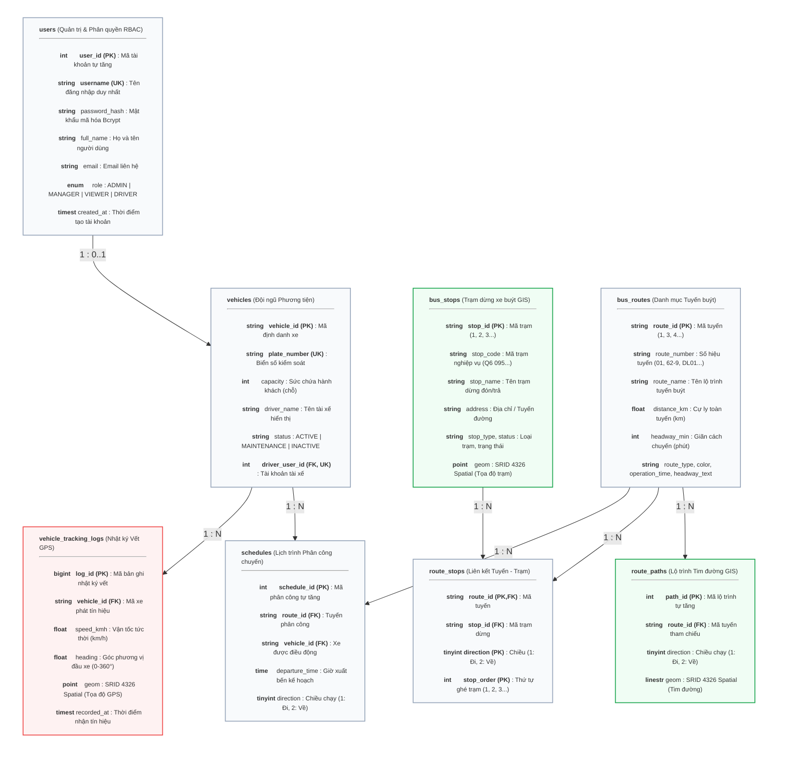

# ĐẶC TẢ THIẾT KẾ CƠ SỞ DỮ LIỆU KHÔNG GIAN (SPATIAL DATABASE SPECIFICATION)
## HỆ THỐNG QUẢN LÝ VÀ GIÁM SÁT HÀNH TRÌNH XE BUÝT 2D (WEB GIS)

> **Tài liệu phục vụ Báo cáo Đồ án Hệ thống Thông tin Địa lý (GIS / Web GIS):** Đặc tả chi tiết cấu trúc CSDL không gian, mô hình thực thể quan hệ (ERD), mô tả chi tiết các mối quan hệ nghiệp vụ, từ điển dữ liệu (Data Dictionary), quy ước hệ quy chiếu trắc địa, cơ chế chỉ mục không gian (Spatial Index) và các hàm không gian OGC. Đối chiếu lại với mã nguồn ngày 12/10/2026. Luồng dữ liệu giữa các thành phần: xem [DATA_FLOW.md](DATA_FLOW.md).

---

## 1. TỔNG QUAN HỆ THỐNG CƠ SỞ DỮ LIỆU KHÔNG GIAN

* **Hệ quản trị CSDL:** **MariaDB 10.4.34** (chạy trong Docker container `bus-gis-mariadb`), Storage Engine `InnoDB` hỗ trợ giao dịch ACID và Spatial Index. Script DDL viết theo cú pháp chung MySQL/MariaDB Spatial.
* **Tên CSDL:** `bus_management_db` (mặc định; đổi bằng biến môi trường `DB_NAME`, cùng `DB_HOST`, `DB_USER`, `DB_PASSWORD` trong `backend/.env`). Lưu ý: `schema.sql` ghi cứng `CREATE DATABASE … bus_management_db; USE bus_management_db;` — `npm run db:import` bỏ hai lệnh này nên chạy đúng với tên tùy chỉnh, còn tự khởi tạo lúc server khởi động thì chạy nguyên tệp, nên chỉ đúng với tên mặc định. Backend kết nối qua pool `mysql2` (tối đa 10 kết nối).
* **Bộ mã ký tự (Charset / Collation):** `utf8mb4` / `utf8mb4_unicode_ci` (hỗ trợ tiếng Việt có dấu và ký tự đa ngôn ngữ).
* **Hệ quy chiếu tọa độ không gian (CRS - Coordinate Reference System):** 
  * **WGS84 (World Geodetic System 1984)** - Mã định danh chuẩn: **EPSG:4326** / **SRID 4326**. Toàn bộ 5.898 trạm và 332 lộ trình hiện có đều mang `ST_SRID(geom) = 4326`.
  * Quy ước thứ tự trục: chuỗi WKT luôn lưu theo thứ tự **`lon lat`** (Kinh độ `longitude` đứng trước, Vĩ độ `latitude` đứng sau), ví dụ `POINT(106.652554 10.750232)`. MariaDB 10.4 xử lý tọa độ theo đúng thứ tự WKT nên không cần tham số `axis-order`. *(Lưu ý khi chuyển sang MySQL 8.x: SRID 4326 mặc định theo thứ tự lat-long, phải truyền thêm `'axis-order=long-lat'` vào `ST_GeomFromText`.)*
  * Phạm vi tọa độ thực tế của dữ liệu trạm (đo trên CSDL): Kinh độ $106.087836^\circ - 107.548143^\circ\text{ E}$, Vĩ độ $8.681083^\circ - 11.522208^\circ\text{ N}$ (bao gồm TP.HCM và các tuyến liên tỉnh lân cận).
* **Chuẩn biểu diễn đối tượng địa lý:** Tuân thủ tiêu chuẩn **OGC SFA (OpenGIS Simple Feature Access)**:
  * Kiểu đối tượng điểm: `POINT(lon lat)` đại diện cho vị trí trạm dừng và vết GPS động của xe.
  * Kiểu đối tượng đường: `LINESTRING(lon1 lat1, lon2 lat2, ...)` đại diện cho quỹ đạo tim đường tuyến xe.
  * Định dạng trao đổi dữ liệu: **GeoJSON (RFC 7946)** thông qua hàm chuẩn hóa `ST_AsGeoJSON()` phục vụ hiển thị trên ArcGIS Maps SDK for JavaScript.

### 1.1. Nguồn dữ liệu và Quy mô CSDL hiện tại

Dữ liệu được tách thành hai tệp trong thư mục `database/`:

| Tệp | Nội dung | Cách nạp |
|---|---|---|
| `schema.sql` | DDL 8 bảng + dữ liệu mẫu: 2 tài khoản (`admin` / `manager`) và 4 xe buýt demo (`BUS_51B_01` … `BUS_51B_04`, chưa gán tài khoản tài xế) | Server tự nạp khi CSDL chưa có bảng `users`; hoặc chạy trực tiếp bằng MySQL/MariaDB client |
| `busdata.sql` | Dữ liệu mạng lưới xe buýt **TP.HCM** thực tế cho 4 bảng tĩnh: `bus_routes`, `bus_stops`, `route_paths`, `route_stops`. Tệp sinh tự động, **không sửa tay** | `cd backend && npm run db:import` (xuất lại: `npm run db:export`) |
| `backend/scripts/seed_drivers.js` | Tài khoản tài xế demo `driver01…driverNN` (role `DRIVER`), xe `DRV_01…DRV_NN` đã gán tài xế, 17 chuyến/ngày mỗi xe | `cd backend && npm run db:seed-drivers -- --count N` (mặc định 20) |

Script `db:import` xóa dữ liệu cũ của 4 bảng tĩnh rồi nạp lại trong **một giao dịch** (`START TRANSACTION`, tạm tắt `FOREIGN_KEY_CHECKS`), đảm bảo CSDL không rơi vào trạng thái nạp dở.

**Thống kê bảng tĩnh** (đếm `COUNT(*)` trên CSDL ngày 04/10/2026; khớp dòng tiêu đề của `busdata.sql`, tệp không đổi từ 03/10/2026):

| Bảng | Số bản ghi | Ghi chú |
|---|---:|---|
| `bus_routes` | 178 | `route_id` từ `1` đến `433` (không liên tục) |
| `bus_stops` | 5.898 | `stop_id` từ `1` đến `10068`; 5.715 trạm *Đang khai thác* |
| `route_paths` | 332 | 178 lộ trình chiều đi + 154 lộ trình chiều về; trung bình 286 đỉnh/lộ trình (min 13, max 1.027) |
| `route_stops` | 13.772 | 7.128 lượt ghé chiều đi + 6.644 lượt ghé chiều về; trung bình ~41,5 trạm/chiều, tối đa 138 trạm |

**Bảng vận hành** — số bản ghi phụ thuộc môi trường; các con số dưới đây **suy ra từ code** (`schema.sql` + `seed_drivers.js` với `--count 20` mặc định), không phải đo trên CSDL:

| Bảng | Sau `schema.sql` | Sau thêm `db:seed-drivers` (20) | Nguồn ghi khác |
|---|---:|---:|---|
| `users` | 2 (1 `ADMIN`, 1 `MANAGER`) | 22 (+20 `DRIVER`) | Cổng Quản trị (UC-18) |
| `vehicles` | 4 | 24 (+20 `DRV_NN`, đã gán tài xế) | Cổng Quản trị (UC-14), nhập JSON |
| `schedules` | 0 | 340 (20 xe × 17 chuyến) | Cổng Quản trị (UC-15) |
| `vehicle_tracking_logs` | 0 | 0 | Tăng khi xe chạy chuyến: tối đa 1 bản ghi / xe / 5 giây (≈ 720 bản ghi / xe / giờ) |

### 1.2. Khởi tạo và di trú cấu trúc CSDL (migration)

Không có công cụ migration riêng; cấu trúc được đảm bảo ở ba chỗ, đều chạy lặp lại an toàn (idempotent):

| Thời điểm | Mã nguồn | Việc làm |
|---|---|---|
| Mỗi lần khởi động server | `initDatabase` trong [db.js](../backend/src/config/db.js) | Tạo CSDL nếu chưa có; nếu chưa có bảng `users` thì nạp `schema.sql` (**không** nạp `busdata.sql` — CSDL mới chưa có tuyến cho tới khi chạy `db:import`); sau đó chạy `migrateDriverSchema`. Lỗi chỉ ghi cảnh báo, server vẫn chạy. |
| Khởi động server và trước khi seed tài xế | `migrateDriverSchema` trong [migrations.js](../backend/src/config/migrations.js) | CSDL tạo từ schema cũ: thêm `'DRIVER'` vào ENUM `users.role`; thêm cột `vehicles.driver_user_id INT NULL UNIQUE` + khóa ngoại `fk_vehicles_driver` (`ON DELETE SET NULL`). Lệnh DDL, chạy ngoài giao dịch. |
| `npm run db:import` | `ensureSchema` trong [import_busdata_sql.js](../backend/scripts/import_busdata_sql.js) | CSDL trống → nạp `schema.sql`; CSDL cũ → bổ sung các cột mới của `bus_routes`/`bus_stops`, đổi khóa chính `route_stops` sang `(route_id, direction, stop_order)`. Sau khi nạp `busdata.sql` (tắt `FOREIGN_KEY_CHECKS`), xóa các `schedules` trỏ tới tuyến không còn tồn tại. |

---

## 2. SƠ ĐỒ THỰC THỂ QUAN HỆ KHÔNG GIAN (SPATIAL ERD)

Biểu đồ dưới đây được thiết kế theo bố cục dạng đứng (Portrait Grid: mỗi dòng 2 bảng) nhằm đảm bảo hiển thị cân đối và sắc nét trên trang in báo cáo A4:



---

## 2.1. MÔ TẢ CHI TIẾT CÁC MỐI QUAN HỆ TRONG SƠ ĐỒ THỰC THỂ QUAN HỆ

Hệ thống cơ sở dữ liệu của đề tài được thiết kế chuẩn hóa theo dạng chuẩn 3 (3NF) kết hợp mở rộng các kiểu dữ liệu không gian OGC. Mối liên kết giữa các thực thể thuộc tính và thực thể không gian được phân chia thành **5 nhóm quan hệ nghiệp vụ cốt lõi** như sau (cách dữ liệu chảy qua các bảng khi hệ thống chạy được mô tả ở [DATA_FLOW.md](DATA_FLOW.md)):

### 1. Quan hệ giữa Tuyến xe buýt và Lộ trình Tim đường (`bus_routes` – `route_paths`): Quan hệ $1 - N$
* **Bản chất nghiệp vụ:** Phần lớn tuyến xe buýt (`bus_routes`) có hai hướng di chuyển độc lập: *Lượt đi (Outbound - Direction 1)* và *Lượt về (Inbound - Direction 2)* với quỹ đạo tim đường số hóa khác nhau do cấu trúc đường một chiều hoặc luồng phân làn giao thông đô thị. Theo dữ liệu thực tế: **154/178 tuyến** có đủ hai chiều, **24 tuyến** chỉ có chiều đi (tuyến vòng khép kín, ví dụ `DL01` *Bến xe buýt Sài Gòn - Thủ Thiêm*, các tuyến gom khách ga Metro số 1). Mọi tuyến đều có ít nhất một lộ trình.
* **Cơ chế liên kết khóa:** Trường `route_id` trong bảng `route_paths` đóng vai trò là Khóa ngoại (Foreign Key) tham chiếu trực tiếp đến Khóa chính `route_id` của bảng `bus_routes`. Cặp `(route_id, direction)` không có ràng buộc `UNIQUE` ở mức CSDL; tính duy nhất (mỗi chiều một `LINESTRING`) do tầng ứng dụng và script nạp dữ liệu đảm bảo — dữ liệu hiện tại không có cặp trùng.
* **Ràng buộc toàn vẹn:** Thiết lập quy tắc **`ON DELETE CASCADE`**. Khi một tuyến xe bị xóa, toàn bộ các đối tượng hình học tim đường (`LINESTRING`) thuộc tuyến đó tự động bị xóa theo, tránh phát sinh dữ liệu mồ côi (orphan records). Thao tác cập nhật khóa dùng hành vi mặc định (`RESTRICT`): không thể đổi `route_id` khi tuyến còn bản ghi con tham chiếu.

### 2. Quan hệ giữa Tuyến xe buýt và Trạm dừng đón/trả (`bus_routes` – `bus_stops`): Quan hệ $M - N$ thông qua bảng `route_stops`
* **Bản chất nghiệp vụ:**
  * Một tuyến xe buýt đi qua và dừng đón/trả khách tại nhiều trạm dừng khác nhau trong hành trình ($1 \text{ Tuyến} \rightarrow N \text{ Trạm}$).
  * Ngược lại, một trạm dừng (ví dụ: *Trạm Thư viện Trung tâm ĐHQG*) có vị trí cố định nhưng đóng vai trò là điểm trung chuyển phục vụ cho nhiều tuyến xe buýt khác nhau cùng khai thác ($1 \text{ Trạm} \rightarrow N \text{ Tuyến}$).
* **Giải pháp chuẩn hóa:** Sử dụng bảng liên kết trung gian **`route_stops`** để tách quan hệ Nhiều – Nhiều ($M - N$) thành hai quan hệ Một – Nhiều ($1 - N$):
  * `bus_routes` $\xrightarrow{1 : N}$ `route_stops` (thông qua khóa ngoại `route_id`).
  * `bus_stops` $\xrightarrow{1 : N}$ `route_stops` (thông qua khóa ngoại `stop_id`).
* **Thuộc tính quan hệ:** Khóa chính tổng hợp bao gồm bộ ba `(route_id, direction, stop_order)`: mỗi vị trí ghé trên một chiều tuyến là duy nhất, cho phép tuyến vòng ghé cùng một trạm nhiều lần (ví dụ trạm đầu = trạm cuối). `stop_id` được đánh chỉ mục riêng để tra các tuyến đi qua một trạm. Đồng thời, trường thuộc tính **`stop_order`** ($1, 2, 3, \dots, n$) quy định thứ tự ghé trạm tuần tự, giúp hệ thống dựng được chuỗi lộ trình đón khách chính xác trên bản đồ.
* **Căn cứ từ dữ liệu thực tế:** Có **24 cặp (tuyến, chiều)** ghé cùng một trạm hơn một lần — nếu dùng khóa `(route_id, stop_id, direction)` thì các bản ghi này sẽ vi phạm khóa chính, vì vậy khóa được đặt trên `stop_order`. Ngoài ra có 1 trạm (`stop_id = 4224`, *Trung tâm VinCom*) chưa thuộc tuyến nào — hợp lệ vì quan hệ phía `bus_stops` là tùy chọn (0..N).
* **Ứng dụng truy vấn:** Chức năng *Tìm chuyến* (trip-plan) tự nối bảng `route_stops` với chính nó theo điều kiện `o.route_id = d.route_id AND o.direction = d.direction AND o.stop_order < d.stop_order` để tìm trạm lên nằm **trước** trạm xuống trên cùng chiều chạy.

### 3. Quan hệ Điều phối Lịch trình Chuyến xe (`bus_routes` – `vehicles` – `schedules`): Quan hệ $1 - N$ đa diện
* **Bản chất nghiệp vụ:** Biểu đồ lịch trình (`schedules`) là thực thể giao tác liên kết giữa Tuyến đường khai thác và Phương tiện vận tải:
  * Một tuyến xe buýt trong ngày sẽ có nhiều khung giờ xuất bến khác nhau ($1 \text{ Tuyến} \rightarrow N \text{ Lịch trình}$).
  * Một phương tiện xe buýt có thể được điều động quay vòng để chạy nhiều chuyến xe trong các khung giờ khác nhau ($1 \text{ Xe} \rightarrow N \text{ Lịch trình}$).
* **Cơ chế liên kết khóa:** Bảng `schedules` chứa hai khóa ngoại:
  * `route_id` tham chiếu đến `bus_routes(route_id)`.
  * `vehicle_id` tham chiếu đến `vehicles(vehicle_id)`.
* **Ý nghĩa:** Mỗi bản ghi là **một chuyến** (xe X chạy tuyến Y chiều Z, xuất bến lúc HH:MM). `departure_time` kiểu `TIME`, không có ngày → lịch lặp lại mỗi ngày. Bảng được dùng ở bốn nơi:
  * Cổng Quản trị: lập và xem biểu đồ phân công.
  * Trang tài xế / simulator: `GET /driver/me` liệt kê các chuyến của xe; `trip:start { schedule_id }` chỉ được chấp nhận khi chuyến thuộc xe của tài xế.
  * Bản đồ công khai: danh sách chuyến cho khách chỉ gồm chuyến đang chạy hoặc có giờ xuất bến (giờ VN) trong khoảng 15 phút trước – 2 giờ sau; ETA của chuyến chưa chạy tính từ `departure_time`.
  * `schedule_id` là khóa của chuyến đang chạy trong bộ nhớ server (registry) và của room Socket.IO `trip:<schedule_id>`.
* **Giới hạn:** CSDL và ứng dụng **không** kiểm tra xung đột (một xe có thể có hai chuyến cùng giờ); không có ràng buộc `UNIQUE` trên `(vehicle_id, departure_time)`.

### 4. Quan hệ Giám sát Hành trình Vết xe thời gian thực (`vehicles` – `vehicle_tracking_logs`): Quan hệ $1 - N$ (Chuỗi thời gian Spatio-Temporal)
* **Bản chất nghiệp vụ:** Trong suốt quá trình xe buýt lăn bánh, thiết bị của tài xế phát tọa độ về máy chủ (điện thoại tối đa 1 gói/giây, simulator 1 gói/0,5 giây). Máy chủ phát mọi gói hợp lệ cho bản đồ nhưng chỉ **ghi tối đa 1 bản ghi / xe / 5 giây** vào `vehicle_tracking_logs`. Một phương tiện (`vehicles`) tích lũy dần chuỗi vết theo thời gian ($1 \text{ Xe} \rightarrow N \text{ Bản ghi GPS}$).
* **Cơ chế liên kết khóa:** Trường `vehicle_id` trong bảng nhật ký là Khóa ngoại tới `vehicles`. Giá trị này **không** do thiết bị gửi lên mà lấy từ phiên Socket.IO `/device` đã xác thực (JWT tài xế → `vehicles.driver_user_id`), nên luôn là xe có thật. Gói được phát cho bản đồ trước, rồi ghi bất đồng bộ; lỗi ghi chỉ được log (có giới hạn), không chặn realtime.
* **Dữ liệu được lưu:** `vehicle_id`, `speed_kmh`, `heading`, `geom`. **Không** lưu `schedule_id` (chuyến) và **không** lưu nhãn thời gian của gói: `recorded_at` là thời điểm CSDL chèn bản ghi (`DEFAULT CURRENT_TIMESTAMP`). Muốn tái hiện theo chuyến phải suy ra từ `schedules` + khoảng thời gian.
* **Tối ưu hóa truy vấn:** Bảng nhật ký vết được đánh chỉ mục kết hợp **`INDEX(vehicle_id, recorded_at)`** và **`SPATIAL INDEX(geom)`**. Cấu trúc này cho phép lọc nhanh lịch sử tọa độ của một xe cụ thể theo khoảng thời gian, làm nền tảng cho chức năng tái hiện vệt hành trình (Playback History) trên bản đồ 2D. *(Hiện tại hệ thống mới ghi vết và thống kê tổng số bản ghi trên Dashboard; giao diện Playback chưa triển khai.)*

### 5. Người dùng, Phân quyền và Gán xe cho tài xế (`users` – `vehicles`): Quan hệ $1 - 0..1$
* **Bản chất nghiệp vụ:** Bảng `users` quản lý tài khoản theo mô hình phân quyền **RBAC (Role-Based Access Control)**: `ADMIN`, `MANAGER` (nhân viên, đăng nhập Cổng Quản trị / bản đồ điều hành) và `DRIVER` (tài xế, đăng nhập trang tài xế để chạy chuyến và phát GPS). `VIEWER` còn trong ENUM nhưng không đăng nhập được.
* **Cơ chế liên kết khóa:** `vehicles.driver_user_id` là Khóa ngoại tới `users(user_id)`, có ràng buộc `UNIQUE` → mỗi tài xế phụ trách tối đa một xe và mỗi xe có tối đa một tài khoản tài xế. Khi xóa tài khoản, `ON DELETE SET NULL` gỡ liên kết, xe và lịch trình vẫn còn. CSDL không kiểm tra `role = 'DRIVER'` cho cột này; ứng dụng kiểm tra khi đăng nhập và khi bắt tay Socket.IO.
* **Ý nghĩa:** Liên kết này quyết định danh tính xe của mọi gói GPS: máy chủ tra `vehicles WHERE driver_user_id = <user_id trong JWT>` mỗi lần đăng nhập, gọi `GET /driver/me` và bắt tay `/device`, nên gán lại xe có hiệu lực ngay. Cổng Quản trị chưa có giao diện gán; hiện gán bằng `db:seed-drivers` hoặc SQL.
* **Phân biệt với `driver_name`:** `vehicles.driver_name` chỉ là tên hiển thị tự do (hiện trong danh sách chuyến của khách), không liên quan tới tài khoản.
* Các bảng dữ liệu không gian không tham chiếu `users`; mọi thao tác ghi dữ liệu bản đồ hay xuất nhập JSON được kiểm soát ở tầng ứng dụng qua **JWT (JSON Web Token)**.

### 📊 Bảng tổng hợp Ma trận Quan hệ và Ràng buộc Toàn vẹn (Integrity Matrix)

| Bảng Cha (Parent Table) | Bảng Con (Child Table) | Khóa Ngoại (Foreign Key) | Loại Quan Hệ | Hành Vi Ràng Buộc (CASCADE / RESTRICT) |
|---|---|---|:---:|---|
| `bus_routes` | `route_paths` | `route_id` | $1 - N$ | `ON DELETE CASCADE`, `ON UPDATE RESTRICT` (mặc định) |
| `bus_routes` | `route_stops` | `route_id` | $1 - N$ | `ON DELETE CASCADE`, `ON UPDATE RESTRICT` (mặc định) |
| `bus_stops` | `route_stops` | `stop_id` | $1 - N$ | `ON DELETE CASCADE`, `ON UPDATE RESTRICT` (mặc định) |
| `bus_routes` | `schedules` | `route_id` | $1 - N$ | `ON DELETE CASCADE`, `ON UPDATE RESTRICT` (mặc định) |
| `vehicles` | `schedules` | `vehicle_id` | $1 - N$ | `ON DELETE CASCADE`, `ON UPDATE RESTRICT` (mặc định) |
| `vehicles` | `vehicle_tracking_logs` | `vehicle_id` | $1 - N$ | `ON DELETE CASCADE`, `ON UPDATE RESTRICT` (mặc định) |
| `users` | `vehicles` | `driver_user_id` (`UNIQUE`, cho phép `NULL`) | $1 - 0..1$ | `ON DELETE SET NULL`, `ON UPDATE RESTRICT` (mặc định) |

> DDL chỉ khai báo `ON DELETE`; mệnh đề `ON UPDATE` không khai báo nên InnoDB áp dụng mặc định `RESTRICT` (từ chối đổi khóa chính khi còn bản ghi con).
>
> **Hệ quả xóa dây chuyền cần lưu ý:** xóa một tuyến xóa luôn lộ trình, liên kết trạm và mọi lịch trình của tuyến; xóa một xe xóa luôn lịch trình và **toàn bộ nhật ký GPS** của xe; xóa một trạm gỡ trạm khỏi mọi tuyến.

---

## 3. TỪ ĐIỂN DỮ LIỆU CHI TIẾT (DATA DICTIONARY)

### 3.1. Bảng `users` (Người dùng & Phân quyền)
* **Ý nghĩa:** Quản lý tài khoản đăng nhập Cổng Quản trị / bản đồ điều hành (ADMIN, MANAGER) và trang tài xế (DRIVER), phân cấp quyền truy cập theo mô hình RBAC (Role-Based Access Control).

| Tên trường | Kiểu dữ liệu | Ràng buộc | Giá trị mặc định | Giải thích nghiệp vụ |
|---|---|---|---|---|
| `user_id` | `INT` | `PK, AUTO_INCREMENT` | Tự tăng | Mã định danh duy nhất của người dùng |
| `username` | `VARCHAR(50)` | `NOT NULL, UNIQUE` | Không | Tên tài khoản đăng nhập hệ thống |
| `password_hash` | `VARCHAR(255)` | `NOT NULL` | Không | Mật khẩu băm an toàn qua thuật toán **Bcrypt (Cost factor = 10)** |
| `full_name` | `VARCHAR(100)` | `NOT NULL` | Không | Họ và tên đầy đủ (hiển thị trên Cổng Quản trị, trang tài xế, lời chào sau đăng nhập) |
| `email` | `VARCHAR(100)` | `NULL` | `NULL` | Địa chỉ thư điện tử liên hệ |
| `role` | `ENUM('ADMIN','MANAGER','VIEWER','DRIVER')` | `NULL` | `'MANAGER'` | Vai trò: `ADMIN` (toàn quyền, kể cả quản lý người dùng), `MANAGER` (quản lý dữ liệu và điều hành), `DRIVER` (tài xế, chỉ trang tài xế và kênh `/device`), `VIEWER` (còn trong ENUM, không đăng nhập được) |
| `created_at` | `TIMESTAMP` | `NOT NULL` | `CURRENT_TIMESTAMP` | Thời điểm khởi tạo tài khoản |

* **Dữ liệu khởi tạo:** `admin` (role `ADMIN`, email `admin@busgis.vn`, mật khẩu `admin123`) và `manager` (role `MANAGER`, email `manager@busgis.vn`, mật khẩu `manager123`), nạp từ `schema.sql`. `db:seed-drivers` thêm `driver01…driverNN` (role `DRIVER`, email `driverNN@busgis.vn`, mật khẩu mặc định `driver123`).
* **Ràng buộc ở tầng ứng dụng:** API người dùng chỉ cho gán `ADMIN`, `MANAGER`, `DRIVER`; mật khẩu không bao giờ trả về qua API (các truy vấn danh sách chỉ chọn cột không nhạy cảm).

---

### 3.2. Bảng `bus_routes` (Thực thể Thuộc tính Tuyến xe buýt)
* **Ý nghĩa:** Lưu trữ thông tin thuộc tính phi không gian của mạng lưới các tuyến xe buýt trong khu vực quản lý.

| Tên trường | Kiểu dữ liệu | Ràng buộc | Giá trị mặc định | Giải thích nghiệp vụ |
|---|---|---|---|---|
| `route_id` | `VARCHAR(20)` | `PRIMARY KEY` | Không | Mã định danh tuyến (giá trị số dạng chuỗi từ `1` đến `433`, không liên tục) |
| `route_number` | `VARCHAR(10)` | `NOT NULL` | Không | Số hiệu nhận diện tuyến, có thể chứa chữ và gạch nối (ví dụ: `01`, `100`, `62-9`, `156D`, `D4`, `HS-04`, `DL01`, `SWB1`) |
| `route_name` | `VARCHAR(150)` | `NOT NULL` | Không | Tên đầy đủ lộ trình (ví dụ: `Ga Ba Son - Bến xe buýt Chợ Lớn`) |
| `distance_km` | `FLOAT` | `NULL` | `0.0` | Tổng chiều dài cự ly tuyến (km); dữ liệu thực tế từ `0.02` đến `180` |
| `headway_min` | `INT` | `NULL` | `15` | Giãn cách tối thiểu giữa 2 chuyến liên tiếp (phút); dữ liệu thực tế từ `1` đến `150` |
| `route_type` | `VARCHAR(60)` | `NULL` | `NULL` | Loại tuyến (xem miền giá trị bên dưới) |
| `color` | `VARCHAR(9)` | `NULL` | `NULL` | Màu hiển thị tuyến trên bản đồ (`#RRGGBB`); 178/178 tuyến đã có màu |
| `operation_time` | `VARCHAR(30)` | `NULL` | `NULL` | Giờ hoạt động (ví dụ: `05:00 - 22:00`) |
| `headway_text` | `VARCHAR(20)` | `NULL` | `NULL` | Giãn cách chuyến dạng khoảng (ví dụ: `8 - 20`) hoặc một giá trị (`60`) |

* **Miền giá trị `route_type` (dữ liệu hiện tại):**

| Giá trị | Số tuyến |
|---|---:|
| `Phổ thông - Có trợ giá` | 114 |
| `Phổ thông - Không trợ giá` | 48 |
| `Học sinh - Có trợ giá` | 7 |
| `Không trợ giá - Du lịch` | 7 |
| `Phổ thông - Có trợ giá - Buýt nhanh` | 2 |

---

### 3.3. Bảng `route_paths` (Thực thể Không gian Lộ trình Tim đường - LineString)
* **Ý nghĩa:** Lưu trữ hình học không gian (Geometry) của tim đường giao thông mà tuyến buýt đi qua, phân biệt theo chiều Lượt đi và Lượt về.

| Tên trường | Kiểu dữ liệu | Ràng buộc | Giá trị mặc định | Giải thích nghiệp vụ |
|---|---|---|---|---|
| `path_id` | `INT` | `PK, AUTO_INCREMENT` | Tự tăng | Mã định danh đoạn lộ trình tim đường |
| `route_id` | `VARCHAR(20)` | `NOT NULL, FK` | Không | Mã tuyến, liên kết `bus_routes(route_id)` (`ON DELETE CASCADE`) |
| `direction` | `TINYINT` | `NOT NULL` | Không | Chiều di chuyển: `1` (Lượt đi - Outbound), `2` (Lượt về - Inbound) |
| `geom` | `LINESTRING` | `NOT NULL, SPATIAL` | Không (SRID 4326) | Chuỗi tọa độ các đỉnh uốn tim đường: `LINESTRING(lon1 lat1, lon2 lat2, ...)`; 13 – 1.027 đỉnh/lộ trình, trung bình 286 |

---

### 3.4. Bảng `bus_stops` (Thực thể Không gian Trạm dừng xe buýt - Point)
* **Ý nghĩa:** Quản lý cơ sở hạ tầng các điểm dừng đón/trả khách cố định trên toàn mạng lưới Web GIS.

| Tên trường | Kiểu dữ liệu | Ràng buộc | Giá trị mặc định | Giải thích nghiệp vụ |
|---|---|---|---|---|
| `stop_id` | `VARCHAR(20)` | `PRIMARY KEY` | Không | Mã định danh trạm dừng (giá trị số dạng chuỗi từ `1` đến `10068`) |
| `stop_code` | `VARCHAR(30)` | `NULL` | `NULL` | Mã trạm nghiệp vụ theo quận/huyện (ví dụ: `Q6 095`, `Q11 001`); 5.898/5.898 trạm đã có mã |
| `stop_name` | `VARCHAR(150)` | `NOT NULL` | Không | Tên trạm dừng (ví dụ: `Chu Văn An`, `Nhà sách Phương Nam`) |
| `address` | `VARCHAR(255)` | `NULL` | `NULL` | Địa chỉ đặt trạm dạng `Số nhà, Tên đường, Quận` (ví dụ: `27, Tháp Mười, Quận 6`); dùng cho chức năng tìm trạm theo địa chỉ |
| `stop_type` | `VARCHAR(50)` | `NULL` | `NULL` | Loại hạ tầng trạm (xem miền giá trị bên dưới) |
| `status` | `VARCHAR(30)` | `NOT NULL` | `'Đang khai thác'` | Trạng thái khai thác của trạm (xem miền giá trị bên dưới) |
| `geom` | `POINT` | `NOT NULL, SPATIAL` | Không (SRID 4326) | Tọa độ điểm địa lý không gian: `POINT(longitude latitude)`, ví dụ `POINT(106.652554 10.750232)` |

* **Miền giá trị `stop_type` và `status` (dữ liệu hiện tại):**

| `stop_type` | Số trạm | | `status` | Số trạm |
|---|---:|---|---|---:|
| `Trụ dừng` | 3.250 | | `Đang khai thác` | 5.715 |
| `Ô sơn` | 1.096 | | `Chưa khai thác` | 145 |
| `Nhà chờ` | 997 | | `Tạm ngưng khai thác` | 20 |
| `Trụ - hộp thông tin` | 294 | | `Không có` | 10 |
| `Bến xe` | 135 | | `Đã hủy` | 8 |
| `Biển treo` | 94 | | | |
| `Trạm tạm` | 15 | | | |
| `Ga Metro Số 1` | 14 | | | |
| `Bãi hậu cần` | 2 | | | |
| `Bến Bãi QH 568` | 1 | | | |

---

### 3.5. Bảng `route_stops` (Quan hệ M-N: Thứ tự Ghé trạm trên Tuyến)
* **Ý nghĩa:** Bảng trung gian giải quyết quan hệ Nhiều - Nhiều giữa Tuyến và Trạm dừng, xác định trình tự ghé trạm (`stop_order`) theo từng chiều di chuyển.

| Tên trường | Kiểu dữ liệu | Ràng buộc | Giá trị mặc định | Giải thích nghiệp vụ |
|---|---|---|---|---|
| `route_id` | `VARCHAR(20)` | `PK, FK` | Không | Mã tuyến buýt, liên kết `bus_routes(route_id)` (`ON DELETE CASCADE`) |
| `stop_id` | `VARCHAR(20)` | `FK, INDEX` | Không | Mã trạm buýt, liên kết `bus_stops(stop_id)` (`ON DELETE CASCADE`) |
| `direction` | `TINYINT` | `PK` | Không | Chiều tuyến áp dụng (`1: Đi`, `2: Về`) |
| `stop_order` | `INT` | `PK` | Không | Số thứ tự đón khách tăng dần của trạm trên tuyến ($1, 2, 3, \dots, n$, tối đa hiện tại là `138`); tuyến vòng có thể ghé 1 trạm ở nhiều vị trí |

---

### 3.6. Bảng `vehicles` (Đội ngũ Phương tiện xe buýt)
* **Ý nghĩa:** Quản lý danh mục phương tiện vận tải đang lăn bánh hoặc thuộc quyền điều động của hệ thống.

| Tên trường | Kiểu dữ liệu | Ràng buộc | Giá trị mặc định | Giải thích nghiệp vụ |
|---|---|---|---|---|
| `vehicle_id` | `VARCHAR(20)` | `PRIMARY KEY` | Không | Mã định danh quản lý nội bộ (ví dụ: `BUS_51B_01`) |
| `plate_number` | `VARCHAR(20)` | `NOT NULL, UNIQUE` | Không | Biển số đăng ký kiểm soát xe (ví dụ: `51B-123.45`) |
| `capacity` | `INT` | `NULL` | `40` | Sức chứa tối đa của xe (số chỗ ngồi + chỗ đứng) |
| `driver_name` | `VARCHAR(100)` | `NULL` | `NULL` | Tên tài xế **hiển thị** (văn bản tự do, nhập trên Cổng Quản trị); hiện trong danh sách chuyến của khách. Không liên kết tài khoản |
| `status` | `VARCHAR(30)` | `NULL` | `'ACTIVE'` | Trạng thái: `ACTIVE` (Hoạt động), `MAINTENANCE` (Bảo trì), `INACTIVE` (Nghỉ). Chỉ để hiển thị; ứng dụng không chặn xe `MAINTENANCE`/`INACTIVE` chạy chuyến |
| `driver_user_id` | `INT` | `NULL, UNIQUE, FK` | `NULL` | Tài khoản tài xế phụ trách xe, liên kết `users(user_id)` qua ràng buộc `fk_vehicles_driver` (`ON DELETE SET NULL`). `NULL` = xe chưa có tài xế, không thể phát GPS |

* **Dữ liệu mẫu (seed trong `schema.sql`):** 4 xe `BUS_51B_01` … `BUS_51B_04` (biển số `51B-123.45`, `51B-678.90`, `51B-888.99`, `51B-456.78`), sức chứa 45 chỗ, trạng thái `ACTIVE`, **chưa gán tài khoản tài xế**. Bảng không nằm trong `busdata.sql` nên `npm run db:import` không nạp/xóa dữ liệu xe.
* **Dữ liệu demo (`db:seed-drivers`):** xe `DRV_01…DRV_NN`, biển số `51B-900.NN`, sức chứa 45, `ACTIVE`, `driver_name = 'Tài xế NN'`, `driver_user_id` trỏ tới tài khoản `driverNN`. Upsert theo `vehicle_id` nên chạy lại không làm mất nhật ký GPS.
* **Ghi chú:** API `GET /vehicles` là công khai và trả `SELECT v.*` (kèm `driver_user_id`) cùng danh sách tuyến được phân công và tổng số chuyến (`GROUP_CONCAT`, `COUNT` qua `schedules`). Cổng Quản trị chỉ sửa 5 cột đầu, không sửa `driver_user_id`.

---

### 3.7. Bảng `schedules` (Biểu đồ Lịch trình Phân công chuyến xe)
* **Ý nghĩa:** Điều phối lịch trình xuất bến trong ngày, ghép nối phương tiện với tuyến đường và khung thời gian chạy.

| Tên trường | Kiểu dữ liệu | Ràng buộc | Giá trị mặc định | Giải thích nghiệp vụ |
|---|---|---|---|---|
| `schedule_id` | `INT` | `PK, AUTO_INCREMENT` | Tự tăng | Mã định danh chuyến xe phân công |
| `route_id` | `VARCHAR(20)` | `NOT NULL, FK` | Không | Tuyến xe thực hiện chuyến, liên kết `bus_routes` |
| `vehicle_id` | `VARCHAR(20)` | `NOT NULL, FK` | Không | Xe buýt được điều động chạy chuyến, liên kết `vehicles` |
| `departure_time`| `TIME` | `NOT NULL` | Không | Giờ xuất bến theo kế hoạch, hiểu theo giờ Việt Nam (UTC+7), lặp lại mỗi ngày (ví dụ: `06:00:00`, `06:30:00`) |
| `direction` | `TINYINT` | `NOT NULL` | Không | Chiều di chuyển của chuyến xe (`1: Đi`, `2: Về`) |

* **Dữ liệu demo (`db:seed-drivers`):** mỗi xe `DRV_NN` có 17 chuyến/ngày, xuất bến `05:00 + slot×15′ + k×60′` (slot = thứ tự tài xế trong tuyến, 0–3; k = 0–16), chiều đổi xen kẽ sau mỗi chuyến → mỗi tuyến có chuyến 15 phút một lần, mỗi chiều trung bình 30 phút một lần. Lịch của xe seed được xóa và tạo lại mỗi lần chạy.
* **Cách đọc giờ:** server dùng `TIME_TO_SEC(departure_time)` để so với số giây trong ngày theo giờ VN, và `TIME_FORMAT(departure_time, '%H:%i')` để trả `HH:MM` cho trang tài xế và danh sách chuyến.

---

### 3.8. Bảng `vehicle_tracking_logs` (Dữ liệu Động Không gian - Thời gian Spatio-Temporal)
* **Ý nghĩa:** Lưu trữ lịch sử di chuyển theo chuỗi thời gian (Time-series GPS Tracking), phục vụ tái hiện lộ trình và phân tích vận tốc xe.

| Tên trường | Kiểu dữ liệu | Ràng buộc | Giá trị mặc định | Giải thích nghiệp vụ |
|---|---|---|---|---|
| `log_id` | `BIGINT` | `PK, AUTO_INCREMENT` | Tự tăng | Mã định danh bản ghi tọa độ vết xe |
| `vehicle_id` | `VARCHAR(20)` | `NOT NULL, FK` | Không | Mã xe phát tín hiệu định vị, liên kết `vehicles` |
| `speed_kmh` | `FLOAT` | `NULL` | `0.0` | Vận tốc tức thời đo được tại thời điểm phát tin ($km/h$) |
| `heading` | `FLOAT` | `NULL` | `0.0` | Góc phương vị di chuyển của đầu xe ($0^\circ - 360^\circ$) |
| `geom` | `POINT` | `NOT NULL, SPATIAL` | Không (SRID 4326) | Tọa độ GPS trắc địa: `POINT(longitude latitude)` |
| `recorded_at` | `TIMESTAMP` | `NOT NULL` | `CURRENT_TIMESTAMP`| Thời điểm CSDL chèn bản ghi (server không truyền nhãn thời gian của gói) |

* **Cách ghi:** [tracking-log.js](../backend/src/sockets/tracking-log.js) chèn `INSERT … VALUES (vehicle_id, speed_kmh, heading, ST_GeomFromText('POINT(lon lat)', 4326))`, tối đa 1 bản ghi / xe / 5 giây (bộ đếm trong bộ nhớ, reset khi khởi động lại server). `speed_kmh` đã được kiểm tra 0–200, `heading` 0–<360.
* **Cách đọc:** hiện chỉ có `SELECT COUNT(*)` cho thống kê Tổng quan; chưa có API đọc lại vết.

---

## 4. CƠ CHẾ CHỈ MỤC KHÔNG GIAN VÀ CÁC HÀM XỬ LÝ GIS (SPATIAL INDEXING & OGC FUNCTIONS)

### 4.1. Cơ chế Chỉ mục Không gian R-Tree (Spatial Indexing)
Trong CSDL MariaDB Spatial, các bảng hình học `bus_stops`, `route_paths` và `vehicle_tracking_logs` đều được đánh chỉ mục không gian:
```sql
SPATIAL INDEX(geom);
```
* **Cơ chế hoạt động:** Chỉ mục không gian sử dụng cấu trúc cây **R-Tree**, chia không gian 2D thành các hình chữ nhật bao tối thiểu (**MBR - Minimum Bounding Box**). 
* **Lợi ích lý thuyết:** Giúp tăng tốc độ truy vấn không gian từ $\mathcal{O}(N)$ (quét tuần tự toàn bảng) xuống xấp xỉ $\mathcal{O}(\log N)$ khi truy vấn dùng các hàm MBR (`MBRContains`, `MBRIntersects`...).
* **Thực tế triển khai trên MariaDB 10.4:** Truy vấn `MBRContains(...)` đi qua chỉ mục R-Tree phát sinh lỗi *"Update locks cannot be acquired during a READ UNCOMMITTED transaction"*. Vì vậy truy vấn tìm trạm lân cận (`trip-plan.service.js`) **không dùng chỉ mục không gian** mà áp dụng lọc hai bước:
  1. **Lọc thô theo hộp bao (bounding box):** quy đổi bán kính mét sang độ ($\Delta lat = r / 111320$, $\Delta lon = r / (111320 \cdot \cos lat)$) rồi lọc `ST_X(geom) BETWEEN ... AND ST_Y(geom) BETWEEN ...`.
  2. **Lọc tinh theo khoảng cách cầu:** giữ các trạm có `ST_Distance_Sphere(...) <= r`.
  
  Với quy mô ~5.900 trạm, phép quét này vẫn đáp ứng tức thời; chỉ mục `SPATIAL INDEX` được giữ lại để sẵn sàng khi nâng cấp phiên bản CSDL.

```sql
-- Các trạm trong bán kính 300 m quanh một điểm (lng, lat)
SELECT stop_id, ST_Distance_Sphere(geom, ST_GeomFromText('POINT(106.6981 10.7720)', 4326)) AS distance_m
FROM bus_stops
WHERE ST_X(geom) BETWEEN 106.6954 AND 106.7008
  AND ST_Y(geom) BETWEEN 10.7693 AND 10.7747
HAVING distance_m <= 300;
```

### 4.2. Danh mục Hàm Không gian OGC được ứng dụng trong Hệ thống

1. **`ST_GeomFromText(wkt_string, srid)`:**
   * *Mục đích:* Chuyển đổi chuỗi văn bản dạng WKT (Well-Known Text) thành đối tượng hình học không gian nhị phân lưu trữ trong CSDL theo chuẩn SRID 4326. Dùng khi thêm/sửa trạm, lộ trình, nhập JSON và ghi vết GPS.
   * *Ví dụ:* `ST_GeomFromText('POINT(106.801960 10.870525)', 4326)`.

2. **`ST_AsGeoJSON(geometry)`:**
   * *Mục đích:* Chuyển đổi đối tượng hình học sang định dạng chuỗi chuẩn **GeoJSON** trực tiếp ở tầng CSDL, giúp máy chủ Node.js gửi thẳng dữ liệu JSON xuống client mà không cần tính toán biến đổi phức tạp.
   * *Ví dụ:* 
     ```sql
     SELECT stop_id, stop_name, address, ST_AsGeoJSON(geom) AS geom_json FROM bus_stops;
     ```

3. **`ST_Distance_Sphere(geom1, geom2)`:**
   * *Mục đích:* Tính khoảng cách trên mặt cầu (đơn vị **mét**) giữa hai điểm kinh–vĩ độ. Ứng dụng trong chức năng *Tìm chuyến*: (a) gom các trạm trong bán kính **300 m** quanh trạm đích (ví dụ trạm phía bên kia đường), (b) chọn trạm lên gần vị trí GPS của người dùng nhất trên từng tuyến.

4. **`ST_X(point)` / `ST_Y(point)`:**
   * *Mục đích:* Trích xuất kinh độ / vĩ độ của điểm, dùng để lọc hộp bao và trả tọa độ dạng số cho client.

5. **`ST_AsText(geometry)`:**
   * *Mục đích:* Xuất hình học ra dạng WKT, dùng trong script `db:export` để sinh tệp `busdata.sql`.

**Nơi sử dụng trong mã nguồn:**

| Hàm | Tệp | Dùng để |
|---|---|---|
| `ST_GeomFromText` | [stops.controller.js](../backend/src/modules/stops/stops.controller.js), [paths.controller.js](../backend/src/modules/paths/paths.controller.js), [import-export.controller.js](../backend/src/modules/import-export/import-export.controller.js), [tracking-log.js](../backend/src/sockets/tracking-log.js), [trip-plan](../backend/src/modules/trip-plan/), [export_busdata_sql.js](../backend/scripts/export_busdata_sql.js) | Ghi trạm, lộ trình, vết GPS; dựng điểm vị trí khách để đo khoảng cách; sinh lệnh `INSERT` trong `busdata.sql` |
| `ST_AsGeoJSON` | [stops.controller.js](../backend/src/modules/stops/stops.controller.js), [paths.controller.js](../backend/src/modules/paths/paths.controller.js), [import-export.controller.js](../backend/src/modules/import-export/import-export.controller.js), [trip-list.js](../backend/src/sockets/trip-list.js) | Trả trạm/lộ trình cho bản đồ; xuất JSON; nạp lộ trình để tính ETA |
| `ST_Distance_Sphere` | [trip-plan.service.js](../backend/src/modules/trip-plan/trip-plan.service.js), [trip-plan.controller.js](../backend/src/modules/trip-plan/trip-plan.controller.js) | Trạm trong 300 m quanh trạm đích; khoảng cách đi bộ từ khách tới từng trạm lên ứng viên |
| `ST_X` / `ST_Y` | [trip-plan.service.js](../backend/src/modules/trip-plan/trip-plan.service.js), [trip-plan.controller.js](../backend/src/modules/trip-plan/trip-plan.controller.js), [trip-list.js](../backend/src/sockets/trip-list.js) | Lọc hộp bao; trả tọa độ số của trạm |
| `ST_AsText` | [export_busdata_sql.js](../backend/scripts/export_busdata_sql.js) | Sinh `busdata.sql` |

**Tính toán hình học ngoài CSDL:** phép chiếu vị trí xe/trạm lên lộ trình và quãng đường dọc tuyến (phục vụ ETA và "trạm kế tiếp" của trang tài xế) **không** dùng hàm SQL mà tính trong Node.js/trình duyệt: server ([route-geometry.js](../backend/src/sockets/route-geometry.js)) cộng dồn khoảng cách haversine giữa các đỉnh và chiếu điểm lên từng đoạn bằng xấp xỉ phẳng cục bộ; trang tài xế ([next-stop.js](../frontend/src/views/driver/features/next-stop.js)) và bản đồ khách ([path-clip.js](../frontend/src/views/map/features/trip-finder/path-clip.js)) dùng phép chiếu phẳng hiệu chỉnh kinh độ theo cos(vĩ độ). Server nạp `route_paths` + `route_stops` một lần cho mỗi (tuyến, chiều) và giữ trong bộ nhớ (xem [DATA_FLOW.md](DATA_FLOW.md)).

---

## 5. MÃ NGUỒN KHỞI TẠO CƠ SỞ DỮ LIỆU ĐẦY ĐỦ (DDL SQL SCRIPT)

Trích nguyên văn từ [`database/schema.sql`](../database/schema.sql) (DDL 8 bảng + dữ liệu mẫu). Dữ liệu 4 bảng tĩnh nằm trong `database/busdata.sql`.

```sql
-- ====================================================================
-- HỆ THỐNG CƠ SỞ DỮ LIỆU QUẢN LÝ XE BUÝT (MYSQL 8.0 / MARIADB SPATIAL)
-- Hệ quy chiếu: WGS84 (SRID 4326), Quy ước trục: axis-order=long-lat
-- ====================================================================

CREATE DATABASE IF NOT EXISTS bus_management_db 
CHARACTER SET utf8mb4 COLLATE utf8mb4_unicode_ci;

USE bus_management_db;

-- Xóa bảng cũ theo thứ tự con → cha (vehicles tham chiếu users, logs/schedules tham chiếu vehicles)
DROP TABLE IF EXISTS vehicle_tracking_logs;
DROP TABLE IF EXISTS schedules;
DROP TABLE IF EXISTS route_stops;
DROP TABLE IF EXISTS route_paths;
DROP TABLE IF EXISTS vehicles;
DROP TABLE IF EXISTS bus_stops;
DROP TABLE IF EXISTS bus_routes;
DROP TABLE IF EXISTS users;

-- 0. Bảng Người dùng & Phân quyền (ADMIN/MANAGER quản trị, DRIVER tài xế)
CREATE TABLE users (
    user_id INT AUTO_INCREMENT PRIMARY KEY,
    username VARCHAR(50) NOT NULL UNIQUE,
    password_hash VARCHAR(255) NOT NULL,
    full_name VARCHAR(100) NOT NULL,
    email VARCHAR(100),
    role ENUM('ADMIN', 'MANAGER', 'VIEWER', 'DRIVER') DEFAULT 'MANAGER',
    created_at TIMESTAMP DEFAULT CURRENT_TIMESTAMP
) ENGINE=InnoDB;

-- 1. Bảng Tuyến xe buýt (Thực thể thuộc tính)
CREATE TABLE bus_routes (
    route_id VARCHAR(20) PRIMARY KEY,
    route_number VARCHAR(10) NOT NULL,
    route_name VARCHAR(150) NOT NULL,
    distance_km FLOAT DEFAULT 0.0,
    headway_min INT DEFAULT 15,
    route_type VARCHAR(60) NULL,
    color VARCHAR(9) NULL,
    operation_time VARCHAR(30) NULL,
    headway_text VARCHAR(20) NULL
) ENGINE=InnoDB;

-- 2. Bảng Lộ trình tuyến đường (Thực thể Không gian: LineString)
CREATE TABLE route_paths (
    path_id INT AUTO_INCREMENT PRIMARY KEY,
    route_id VARCHAR(20) NOT NULL,
    direction TINYINT NOT NULL COMMENT '1: Đi, 2: Về',
    geom LINESTRING NOT NULL /* SRID 4326 */,
    SPATIAL INDEX(geom),
    FOREIGN KEY (route_id) REFERENCES bus_routes(route_id) ON DELETE CASCADE
) ENGINE=InnoDB;

-- 3. Bảng Trạm dừng xe buýt (Thực thể Không gian: Point)
CREATE TABLE bus_stops (
    stop_id VARCHAR(20) PRIMARY KEY,
    stop_code VARCHAR(30) NULL,
    stop_name VARCHAR(150) NOT NULL,
    address VARCHAR(255),
    stop_type VARCHAR(50) NULL,
    status VARCHAR(30) NOT NULL DEFAULT 'Đang khai thác',
    geom POINT NOT NULL /* SRID 4326 */,
    SPATIAL INDEX(geom)
) ENGINE=InnoDB;

-- 4. Bảng liên kết Thứ tự Trạm dừng trên Tuyến (Quan hệ M - N)
-- PK theo (route_id, direction, stop_order): một trạm có thể ghé nhiều lần trên tuyến vòng
CREATE TABLE route_stops (
    route_id VARCHAR(20) NOT NULL,
    stop_id VARCHAR(20) NOT NULL,
    direction TINYINT NOT NULL,
    stop_order INT NOT NULL,
    PRIMARY KEY (route_id, direction, stop_order),
    INDEX (stop_id),
    FOREIGN KEY (route_id) REFERENCES bus_routes(route_id) ON DELETE CASCADE,
    FOREIGN KEY (stop_id) REFERENCES bus_stops(stop_id) ON DELETE CASCADE
) ENGINE=InnoDB;

-- 5. Bảng Phương tiện xe buýt
CREATE TABLE vehicles (
    vehicle_id VARCHAR(20) PRIMARY KEY,
    plate_number VARCHAR(20) NOT NULL UNIQUE,
    capacity INT DEFAULT 40,
    driver_name VARCHAR(100),
    status VARCHAR(30) DEFAULT 'ACTIVE',
    driver_user_id INT NULL UNIQUE,                  -- Tài khoản tài xế phụ trách (1 tài xế ↔ 1 xe)
    CONSTRAINT fk_vehicles_driver FOREIGN KEY (driver_user_id) REFERENCES users(user_id) ON DELETE SET NULL
) ENGINE=InnoDB;

-- 6. Bảng Lịch trình khởi hành
CREATE TABLE schedules (
    schedule_id INT AUTO_INCREMENT PRIMARY KEY,
    route_id VARCHAR(20) NOT NULL,
    vehicle_id VARCHAR(20) NOT NULL,
    departure_time TIME NOT NULL,
    direction TINYINT NOT NULL,
    FOREIGN KEY (route_id) REFERENCES bus_routes(route_id) ON DELETE CASCADE,
    FOREIGN KEY (vehicle_id) REFERENCES vehicles(vehicle_id) ON DELETE CASCADE
) ENGINE=InnoDB;

-- 7. Bảng Nhật ký vết xe (Spatial Temporal: Điểm động theo thời gian)
CREATE TABLE vehicle_tracking_logs (
    log_id BIGINT AUTO_INCREMENT PRIMARY KEY,
    vehicle_id VARCHAR(20) NOT NULL,
    speed_kmh FLOAT DEFAULT 0.0,
    heading FLOAT DEFAULT 0.0,
    geom POINT NOT NULL,
    recorded_at TIMESTAMP DEFAULT CURRENT_TIMESTAMP,
    SPATIAL INDEX(geom),
    INDEX(vehicle_id, recorded_at),
    FOREIGN KEY (vehicle_id) REFERENCES vehicles(vehicle_id) ON DELETE CASCADE
) ENGINE=InnoDB;

-- ====================================================================
-- SEED DỮ LIỆU MẪU (tài khoản & xe buýt)
-- ====================================================================

-- Nạp Tài khoản Quản trị mẫu (Mật khẩu: admin123 / manager123)
INSERT INTO users (username, password_hash, full_name, email, role) VALUES
('admin', '$2b$10$be/YCW2AyTX1gvBhWxR5cOS1Ge1cKIogArSfSYQ.Aj79eofoXleWK', 'Quản trị viên Hệ thống', 'admin@busgis.vn', 'ADMIN'),
('manager', '$2b$10$PuxC1Sqo0DlyCRYGpQj8buYs8D0JMXfx.921s1thBPsbnW1aIS7Om', 'Quản lý Điều hành', 'manager@busgis.vn', 'MANAGER');

-- Tuyến, trạm, lộ trình và trạm-tuyến TP.HCM nằm trong database/busdata.sql
-- Nạp bằng: cd backend && npm run db:import

-- Nạp Xe buýt
INSERT INTO vehicles (vehicle_id, plate_number, capacity, driver_name, status) VALUES
('BUS_51B_01', '51B-123.45', 45, 'Nguyễn Văn A', 'ACTIVE'),
('BUS_51B_02', '51B-678.90', 45, 'Trần Văn B', 'ACTIVE'),
('BUS_51B_03', '51B-888.99', 45, 'Lê Văn C', 'ACTIVE'),
('BUS_51B_04', '51B-456.78', 45, 'Phạm Văn D', 'ACTIVE');
```
