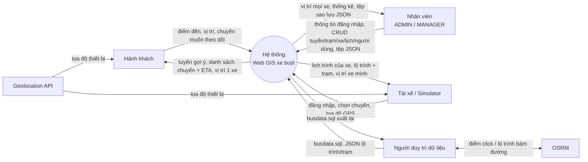
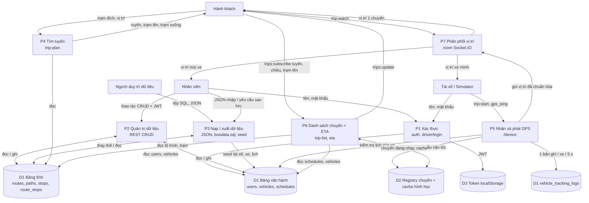
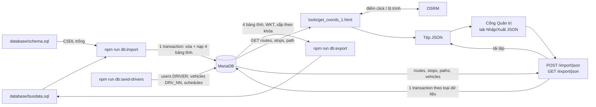
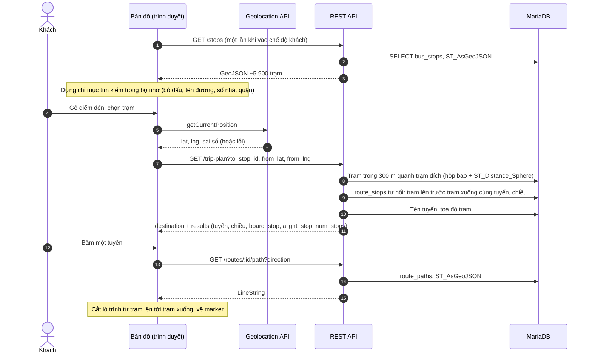
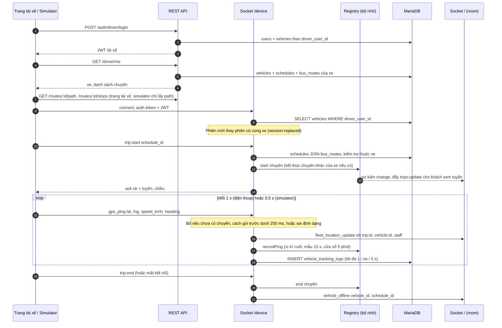
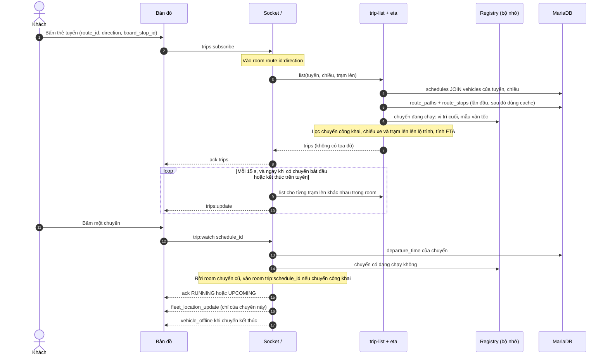

# LUỒNG DỮ LIỆU (DATA FLOW) — HỆ THỐNG WEB GIS GIÁM SÁT XE BUÝT 2D

> Tài liệu mô tả dữ liệu đi từ đâu, qua xử lý nào, được lưu ở đâu và tới ai. Tổng hợp từ mã nguồn ngày 12/10/2026 (`backend/`, `frontend/`, `simulator/`, `tools/`, `database/`).
> Tài liệu liên quan: cấu trúc bảng ở [DATABASE_SPECIFICATION.md](DATABASE_SPECIFICATION.md), chức năng theo tác nhân ở [USE_CASES.md](USE_CASES.md) (các mã UC-xx bên dưới trỏ tới tài liệu này).

---

## 1. Thành phần và kho dữ liệu

### 1.1. Thành phần xử lý

| Ký hiệu | Thành phần | Mã nguồn | Giao tiếp |
|---|---|---|---|
| **P-MAP** | Bản đồ công khai (khách + nhân viên) | `frontend/index.html`, `src/views/map/` | REST `/api/v1`, Socket.IO namespace `/` |
| **P-ADM** | Cổng Quản trị | `frontend/admin.html`, `src/views/admin/` | REST `/api/v1` |
| **P-DRV** | Trang tài xế (điện thoại) | `frontend/driver.html`, `src/views/driver/` | REST, Socket.IO `/` (nhận) và `/device` (phát GPS) |
| **P-SIM** | Simulator — tài xế ảo (công cụ demo) | `simulator/` | REST, Socket.IO `/device` |
| **P-API** | REST API (Express) | `backend/src/modules/*` | HTTP JSON ↔ MariaDB |
| **P-RT** | Hub realtime (Socket.IO) | `backend/src/sockets/` | `/device` vào, `/` ra; đọc/ghi MariaDB |
| **P-CLI** | Script dữ liệu | `backend/scripts/` (`db:import`, `db:export`, `db:seed-drivers`) | Kết nối trực tiếp MariaDB, đọc/ghi tệp `.sql` |
| **P-TOOL** | Công cụ ngoại tuyến | `tools/get_coords_1.html`, `tools/google_maps_importer.html` | Đọc REST công khai, gọi OSRM; xuất tệp JSON |

Backend (P-API + P-RT) chạy trong **một process Node.js**, cổng 3000, và phục vụ luôn giao diện tĩnh (`/frontend`, `/tools`) cùng origin.

### 1.2. Kho dữ liệu

| Ký hiệu | Kho | Nội dung | Tồn tại |
|---|---|---|---|
| **D1** | MariaDB `bus_management_db` | 8 bảng: `bus_routes`, `route_paths`, `bus_stops`, `route_stops` (tĩnh); `users`, `vehicles`, `schedules`, `vehicle_tracking_logs` (vận hành) | Bền vững |
| **D2** | Bộ nhớ process backend | Registry chuyến đang chạy (`schedule_id` → xe, tuyến, chiều, vị trí cuối, mẫu vận tốc 5 phút); `activeDevices` (xe → phiên `/device` đang giữ xe); `liveTrips` (xe → chuyến đang chạy); cache hình học lộ trình + vị trí trạm theo (tuyến, chiều); danh sách room tuyến đang có khách xem; bộ đếm giới hạn ghi log / cảnh báo | Mất khi khởi động lại backend |
| **D3** | Trình duyệt | `localStorage`: `bus_admin_token` (bản đồ + admin dùng chung), `bus_driver_token` (trang tài xế). Bộ nhớ trang: chỉ mục ~5.900 trạm để tìm kiếm, trạng thái bản đồ, chuyến đang theo dõi | Token: tới khi đăng xuất/hết hạn; còn lại: theo phiên trang |
| **D4** | Tệp | `database/schema.sql`, `database/busdata.sql` (sinh tự động), tệp JSON xuất/nhập | Bền vững, quản lý bằng git |

### 1.3. Dịch vụ bên ngoài

| Dịch vụ | Ai dùng | Dữ liệu trao đổi |
|---|---|---|
| ArcGIS Maps SDK + basemap (`js.arcgis.com`) | P-MAP, P-ADM, P-DRV | Thư viện bản đồ và ô nền; không gửi dữ liệu nghiệp vụ |
| Socket.IO client (`cdn.socket.io`) | P-MAP, P-DRV | Thư viện |
| Geolocation API của trình duyệt | P-MAP (vị trí khách), P-DRV (GPS xe) | Tọa độ thiết bị, chỉ đọc trên HTTPS hoặc `localhost` |
| OSRM công khai (`router.project-osrm.org`) | P-TOOL | Gửi chuỗi điểm click, nhận lộ trình bám đường (GeoJSON) |
| Leaflet + ô nền OSM / Google vệ tinh | P-TOOL | Thư viện và ô nền |

---

## 2. Sơ đồ ngữ cảnh (DFD mức 0)



---

## 3. Sơ đồ luồng dữ liệu mức 1



---

## 4. Các luồng chi tiết

### 4.1. Nạp, xuất và cập nhật dữ liệu nền (UC-16, UC-17, UC-20, UC-22)



1. **`db:import`** ([import_busdata_sql.js](../backend/scripts/import_busdata_sql.js)): đảm bảo cấu trúc (nạp `schema.sql` nếu CSDL trống; bổ sung cột / đổi khóa `route_stops` nếu CSDL cũ) → chạy `busdata.sql`: `SET FOREIGN_KEY_CHECKS = 0`, `START TRANSACTION`, `DELETE` 4 bảng tĩnh, `INSERT` lại, `COMMIT` → xóa `schedules` mồ côi → đối chiếu số dòng với tiêu đề tệp. Không đụng `users`, `vehicles`, `vehicle_tracking_logs`.
2. **`db:export`** ([export_busdata_sql.js](../backend/scripts/export_busdata_sql.js)): `SELECT` 4 bảng tĩnh (hình học qua `ST_AsText`), sắp theo khóa ổn định, ghi mỗi bản ghi một dòng để `git diff` gọn.
3. **Công cụ get_coords_1** chỉ **đọc** CSDL qua REST công khai; kết quả (gói `full_package` gồm `route_id`, `stops[]`, `routeGeometry`) đi qua tệp JSON rồi được nhân viên nạp ở Cổng Quản trị.
4. **`POST /import/json`** ([import-export.controller.js](../backend/src/modules/import-export/import-export.controller.js)): một transaction; tùy loại sẽ thay `route_paths` của (tuyến, chiều), upsert `bus_stops`, xóa rồi gán lại `route_stops` của (tuyến, chiều), upsert `bus_routes` / `vehicles`. Lỗi bất kỳ → rollback toàn bộ.
5. **`GET /export/json`**: đọc `bus_routes`, `bus_stops`, `route_paths`, `vehicles` → tệp JSON. **Không** gồm `route_stops`, `schedules`, `users`, `vehicle_tracking_logs`.
6. **`db:seed-drivers`** ([seed_drivers.js](../backend/scripts/seed_drivers.js)): chạy migration tài xế → chọn tuyến đủ 2 chiều → một transaction upsert `users` + `vehicles`, thay `schedules` của xe seed, xóa bản ghi seed thừa.

### 4.2. Quản trị dữ liệu qua REST (UC-10 … UC-18)

```
Cổng Quản trị ──(JSON + Authorization: Bearer <JWT>)──▶ authenticateToken ─▶ requireStaff / requireAdmin ─▶ controller ─▶ dbPool.query ─▶ MariaDB
             ◀──────────────(JSON kết quả / lỗi 400·401·403·500)──────────────────────────────────────────────────────────┘
```

- Mọi API ghi yêu cầu JWT nhân viên; `users` (thêm/sửa/xóa) yêu cầu ADMIN. Các API đọc danh mục (`GET /routes`, `/stops`, `/paths`, `/routes/:id/path`, `/routes/:id/stops`, `/vehicles`, `/schedules`, `/trip-plan`) là công khai.
- Tọa độ nhập dạng số `longitude`, `latitude` → server dựng WKT `POINT(lon lat)` → `ST_GeomFromText(…, 4326)`. Tọa độ trả về dạng GeoJSON qua `ST_AsGeoJSON`.
- Xóa có dây chuyền ở CSDL: xóa tuyến → lộ trình, liên kết trạm, lịch trình; xóa trạm → liên kết trạm của mọi tuyến; xóa xe → lịch trình + nhật ký GPS; xóa tài khoản → `vehicles.driver_user_id = NULL`.
- Thay đổi qua REST **không** được đẩy realtime tới bản đồ đang mở; trang khác chỉ thấy khi tải lại dữ liệu (xem mục 6).

### 4.3. Xác thực và token

| Bước | Nhân viên (bản đồ, admin) | Tài xế (trang tài xế, simulator) |
|---|---|---|
| Đăng nhập | `POST /auth/login` → so khớp bcrypt → chỉ ADMIN/MANAGER | `POST /auth/driver/login` → bcrypt → chỉ DRIVER **và** đã có xe (`vehicles.driver_user_id`) |
| JWT payload | `{ user_id, username, full_name, role }`, hạn 24 giờ | `{ user_id, username, full_name, role: "DRIVER", vehicle_id }`, hạn 12 giờ |
| Lưu ở client | `localStorage.bus_admin_token` (dùng chung bản đồ + admin) | `localStorage.bus_driver_token` (simulator giữ trong bộ nhớ) |
| Kiểm tra lại | `GET /auth/me` khi mở trang | `GET /driver/me` khi mở trang (trả hồ sơ, xe, lịch trình) |
| Socket `/` | Token nhân viên → room `staff` | Token tài xế → room `vehicle:<vehicle_id>` |
| Socket `/device` | — | JWT DRIVER bắt buộc; server tra lại xe từ CSDL mỗi lần bắt tay |

Danh tính xe **luôn** lấy từ CSDL theo `user_id` trong token (không tin `vehicle_id` trong token hay trong gói GPS), nên gán lại xe có hiệu lực ngay ở lần đăng nhập / kết nối kế tiếp.

### 4.4. Khách tìm tuyến (UC-02, UC-03, UC-04)



- Vị trí của khách chỉ gửi lên server dưới dạng tham số truy vấn của `GET /trip-plan`; **không** lưu vào CSDL.
- Tìm trạm theo tên/địa chỉ chạy hoàn toàn ở trình duyệt trên chỉ mục đã tải.

### 4.5. Tài xế phát GPS (UC-19, UC-23)



Gói vị trí do server dựng lại: `{ vehicle_id, plate_number, schedule_id, route_id, route_number, direction, latitude, longitude, speed_kmh, heading, timestamp }`. Từ thiết bị chỉ lấy 4 trường `latitude`, `longitude`, `speed_kmh`, `heading`; phần còn lại lấy từ phiên đã xác thực và chuyến đã `trip:start`; `timestamp` là giờ server.

### 4.6. Khách xem danh sách chuyến, ETA và theo dõi một xe (UC-05)



- **Chuyến công khai:** đang có trong registry, hoặc `departure_time` (giờ VN) nằm trong khoảng 15 phút trước – 2 giờ sau.
- **ETA chuyến đang chạy:** (vị trí trạm lên dọc tuyến − vị trí xe dọc tuyến) ÷ vận tốc thực tế. Vận tốc = quãng đã đi dọc tuyến trong cửa sổ mẫu 5 phút (cần ≥ 2 phút), kẹp 5–60 km/h; thiếu dữ liệu thì dùng trung bình `speed_kmh`, rồi mặc định 20 km/h. Xe vượt trạm lên quá 30 m → `PASSED`.
- **ETA chuyến sắp tới:** max(giờ xuất bến, bây giờ) + (vị trí trạm lên dọc tuyến ÷ vận tốc trung bình của các xe đang chạy trên tuyến).
- `trips:update` chỉ chứa `schedule_id`, `departure_time`, `plate_number`, `driver_name`, `status`, `eta_board`, `minutes_to_board`; tọa độ xe chỉ đi qua room `trip:<schedule_id>`.

### 4.7. Nhân viên giám sát đội xe

1. Đăng nhập trên bản đồ → socket `/` được tạo lại kèm token nhân viên → vào room `staff`.
2. Mọi `fleet_location_update` / `vehicle_offline` của mọi xe tới room `staff`; trình duyệt lọc theo tuyến đang chọn, nội suy chuyển động marker.
3. Không có ảnh chụp trạng thái ban đầu: xe chỉ hiện khi gửi gói kế tiếp (thường ≤ 1 giây với xe đang chạy).

### 4.8. Thống kê tổng quan (UC-10)

`GET /admin/stats` → 6 truy vấn `SELECT COUNT(*)` trên `bus_routes`, `bus_stops`, `vehicles`, `schedules`, `users`, `vehicle_tracking_logs` → JSON kèm `server_time`. Không có bộ nhớ đệm.

---

## 5. Ma trận đọc/ghi dữ liệu (bảng × module)

Ký hiệu: **C** thêm · **R** đọc · **U** sửa (kể cả upsert `ON DUPLICATE KEY UPDATE`) · **D** xóa · **d** bị xóa dây chuyền do khóa ngoại khi module xóa bảng cha · **n** đặt `NULL` do khóa ngoại.

| Module | `bus_routes` | `route_paths` | `bus_stops` | `route_stops` | `users` | `vehicles` | `schedules` | `vehicle_tracking_logs` |
|---|:-:|:-:|:-:|:-:|:-:|:-:|:-:|:-:|
| [auth](../backend/src/modules/auth/auth.controller.js) | | | | | R | | | |
| [driver](../backend/src/modules/driver/driver.controller.js) | R | | | | R | R | R | |
| [users](../backend/src/modules/users/users.controller.js) | | | | | CRUD | n | | |
| [bus-routes](../backend/src/modules/bus-routes/bus-routes.controller.js) | CRUD | R d | | R d | | | d | |
| [paths](../backend/src/modules/paths/paths.controller.js) | R | CRD | | | | | | |
| [stops](../backend/src/modules/stops/stops.controller.js) | | | CRUD | CRUD d | | | | |
| [trip-plan](../backend/src/modules/trip-plan/) | R | | R | R | | | | |
| [vehicles](../backend/src/modules/vehicles/vehicles.controller.js) | R | | | | | CRUD | R d | d |
| [schedules](../backend/src/modules/schedules/schedules.controller.js) | R | | | | | R | CRUD | |
| [admin-stats](../backend/src/modules/admin-stats/admin-stats.controller.js) | R | | R | | R | R | R | R |
| [import-export](../backend/src/modules/import-export/import-export.controller.js) | CRU | CRD | CRU | CUD | | CRU | | |
| [device socket](../backend/src/sockets/device.socket.js) + [device.auth](../backend/src/sockets/device.auth.js) | R | | | | | R | R | |
| [viewer socket](../backend/src/sockets/viewer.socket.js) | | | | | | R | R | |
| [trip-list](../backend/src/sockets/trip-list.js) | | R | R | R | | R | R | |
| [tracking-log](../backend/src/sockets/tracking-log.js) | | | | | | | | C |
| [db:import](../backend/scripts/import_busdata_sql.js) (qua `busdata.sql`) | CD | CD | CD | CD | | | D | |
| [db:export](../backend/scripts/export_busdata_sql.js) | R | R | R | R | | | | |
| [db:seed-drivers](../backend/scripts/seed_drivers.js) | R | R | | | CRUD | CRUD | CD | d |

Nhận xét:
- `vehicle_tracking_logs` chỉ có **một** điểm ghi (tracking-log) và **một** điểm đọc (đếm số bản ghi).
- `schedules` được đọc bởi 5 module, trong đó 3 module thuộc realtime (device, viewer, trip-list).
- `users` chỉ được đọc lúc đăng nhập / hồ sơ; socket không đọc `users` mà tin JWT, rồi tra `vehicles` theo `user_id`.

---

## 6. Tính nhất quán và giới hạn của luồng dữ liệu

| Vấn đề | Hệ quả | Nguồn |
|---|---|---|
| Cache hình học lộ trình + trạm (D2) không bao giờ bị làm mới khi đang chạy | Sửa lộ trình/trạm qua Cổng Quản trị hoặc nhập JSON thì ETA vẫn dùng hình học cũ cho tới khi khởi động lại backend (lộ trình chưa có thì không cache, lần sau nạp lại) | [trip-list.js](../backend/src/sockets/trip-list.js) |
| Registry chuyến đang chạy chỉ nằm trong bộ nhớ một process | Khởi động lại backend → mất danh sách chuyến đang chạy cho tới khi thiết bị kết nối lại và gửi lại `trip:start` (trang tài xế và simulator tự làm); không chạy được nhiều instance | [trip-registry.js](../backend/src/sockets/trip-registry.js) |
| Nhật ký GPS không lưu `schedule_id` và nhãn thời gian của gói | Không tách được vết theo chuyến; `recorded_at` là giờ CSDL chèn | [tracking-log.js](../backend/src/sockets/tracking-log.js) |
| Thay đổi dữ liệu qua REST không phát sự kiện realtime | Bản đồ và trang tài xế đang mở không thấy tuyến/trạm/lịch mới cho tới khi tải lại; danh sách chuyến của khách tự cập nhật ở lần đẩy kế tiếp (≤ 15 s) vì đọc `schedules` mỗi lần | REST modules |
| Nhân viên không nhận ảnh chụp vị trí ban đầu | Mở bản đồ thấy xe dần dần theo gói GPS tới | [viewer.socket.js](../backend/src/sockets/viewer.socket.js) |
| Sao lưu JSON không đầy đủ | Thiếu `route_stops`, `schedules`, `users`, nhật ký GPS; khôi phục `full_backup` bỏ qua `paths` | [import-export.controller.js](../backend/src/modules/import-export/import-export.controller.js) |
| `db:import` nạp với `FOREIGN_KEY_CHECKS = 0` | Lịch trình trỏ tới tuyến bị xóa được dọn sau khi nạp; liên kết khác không được kiểm tra lại | [import_busdata_sql.js](../backend/scripts/import_busdata_sql.js) |
| Giờ xuất bến không gắn ngày | Mọi phép so sánh dùng số giây trong ngày theo giờ VN (UTC+7 cố định); chuyến qua nửa đêm không được xử lý riêng | [eta.js](../backend/src/sockets/eta.js), [schedule.js](../simulator/src/schedule.js) |
