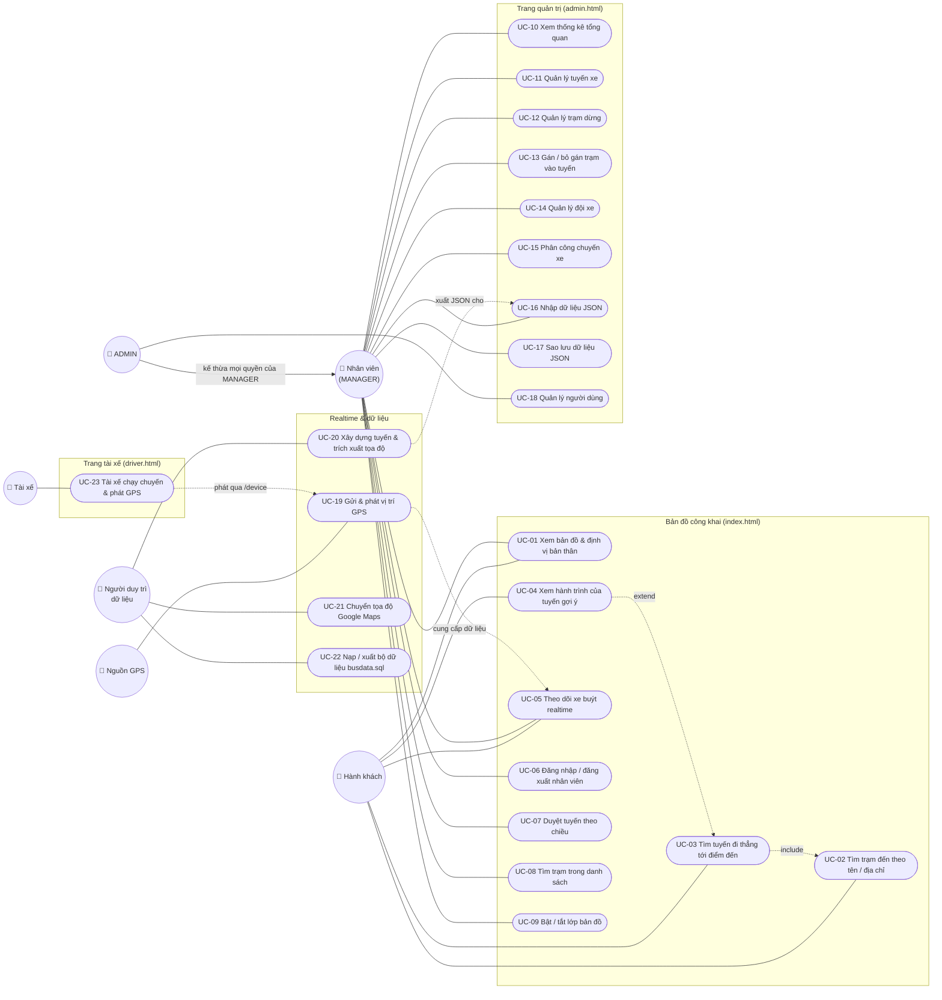

# ĐẶC TẢ USE CASE — HỆ THỐNG WEB GIS GIÁM SÁT XE BUÝT 2D

> Tài liệu được tổng hợp từ mã nguồn hiện tại (backend `backend/src`, frontend `frontend/src`, công cụ `tools/`, script `backend/scripts`). Chỉ mô tả những chức năng **đã cài đặt**; các chức năng chưa có được liệt kê ở mục [7. Hạn chế / chưa hỗ trợ](#7-hạn-chế--chưa-hỗ-trợ).

---

## 1. Tổng quan

Hệ thống gồm ba giao diện và một kênh realtime:

| Thành phần | Tệp / đường dẫn | Ai dùng |
|---|---|---|
| Bản đồ công khai | `frontend/index.html` → `src/views/map/` | Hành khách (không đăng nhập) và nhân viên |
| Trang quản trị (Admin Portal) | `frontend/admin.html` → `src/views/admin/` | ADMIN, MANAGER |
| REST API | `http://localhost:3000/api/v1` (`backend/src/modules/*`) | Hai trang trên |
| Hub realtime Socket.io | `backend/src/sockets/` — namespace `/` (viewer, chỉ nhận) và `/device` (tài xế, JWT) | Tài xế / simulator gửi lên, bản đồ nhận về |
| Trang tài xế | `frontend/driver.html` → `src/views/driver/` | Tài xế (DRIVER) |
| Công cụ dữ liệu ngoại tuyến | `tools/get_coords_1.html`, `tools/google_maps_importer.html`, `npm run db:import / db:export` | Người duy trì dữ liệu |

Dữ liệu hiện có: 178 tuyến, 5.898 trạm, 332 lộ trình xe buýt TP.HCM (`database/busdata.sql`), cùng 4 xe và 2 tài khoản mẫu (`database/schema.sql`).

---

## 2. Tác nhân (Actors)

| Tác nhân | Mô tả | Cách xác định trong code |
|---|---|---|
| **Hành khách (Khách)** | Người dùng ẩn danh mở bản đồ để tìm tuyến và xem xe chạy. Không cần tài khoản. | Không có token hoặc token không hợp lệ → `applyAuthState(null)` hiển thị `guestTripPanel` ([staff-auth.js](../frontend/src/views/map/features/staff-auth.js)) |
| **Quản lý điều hành (MANAGER)** | Nhân viên vận hành. Được làm mọi thao tác quản trị dữ liệu **trừ** thêm/sửa/xóa người dùng. | `role = 'MANAGER'`; các route ghi dữ liệu yêu cầu `authenticateToken` + `requireStaff` |
| **Quản trị viên (ADMIN)** | Có toàn bộ quyền của MANAGER, thêm quyền quản lý tài khoản người dùng. | `role = 'ADMIN'`; route `/users` (POST/PUT/DELETE) có thêm `requireAdmin` ([auth.js](../backend/src/middleware/auth.js)) |
| **Tài xế (DRIVER)** | Người lái xe. Đăng nhập trang tài xế, chọn chuyến của xe mình, xem bản đồ tuyến và phát GPS từ điện thoại. | `role = 'DRIVER'`, được gán xe qua `vehicles.driver_user_id`; đăng nhập qua `POST /auth/driver/login` |
| **Nguồn GPS** (tác nhân hệ thống) | Thiết bị phát `gps_ping` qua namespace `/device`: điện thoại của tài xế hoặc simulator (tài xế ảo, công cụ demo trong `simulator/`). | Phải có JWT của tài xế đã gán xe; server tự điền danh tính xe |
| **Người duy trì dữ liệu** | Thành viên nhóm xây dựng/cập nhật bộ dữ liệu tuyến–trạm–lộ trình bằng công cụ ngoại tuyến và script CLI. | Chạy `npm run db:import`, `npm run db:export`, mở các tệp trong `tools/` |

**Ghi chú về vai trò `VIEWER`:** giá trị này có trong ENUM của bảng `users` nhưng **không sử dụng được** — `POST /auth/login` trả 403 với mọi vai trò khác ADMIN/MANAGER, và form tạo người dùng chỉ cho chọn ADMIN hoặc MANAGER.

ADMIN và MANAGER gọi chung là **Nhân viên** trong tài liệu này.

---

## 3. Sơ đồ use case

---

## 4. Bảng tổng hợp use case

| ID | Tên use case | Tác nhân | Màn hình | API / kênh chính |
|---|---|---|---|---|
| UC-01 | Xem bản đồ & định vị bản thân | Khách, Nhân viên | Bản đồ | — (ArcGIS, Geolocation API) |
| UC-02 | Tìm trạm đến theo tên / địa chỉ | Khách | Bản đồ – panel "Tìm tuyến xe buýt" | `GET /stops` (nạp một lần) |
| UC-03 | Tìm tuyến đi thẳng tới điểm đến | Khách | Bản đồ – panel "Tìm tuyến xe buýt" | `GET /trip-plan` |
| UC-04 | Xem hành trình của tuyến gợi ý | Khách | Bản đồ | `GET /routes/:id/path` |
| UC-05 | Theo dõi xe buýt realtime | Khách, Nhân viên | Bản đồ – bảng "Theo dõi xe" | Socket `fleet_location_update` |
| UC-06 | Đăng nhập / đăng xuất nhân viên | Nhân viên | Modal đăng nhập (bản đồ), màn hình đăng nhập (admin) | `POST /auth/login`, `GET /auth/me` |
| UC-07 | Duyệt tuyến theo chiều | Nhân viên | Bản đồ – panel "Lộ trình xe buýt" | `GET /routes`, `GET /routes/:id/path`, `GET /routes/:id/stops`, `GET /stops` |
| UC-08 | Tìm trạm trong danh sách đang hiển thị | Nhân viên | Bản đồ – panel "Lộ trình xe buýt" | — (lọc phía client) |
| UC-09 | Bật / tắt lớp bản đồ | Nhân viên | Bản đồ – panel "Lộ trình xe buýt" | — |
| UC-10 | Xem thống kê tổng quan | Nhân viên | Admin – tab Tổng quan | `GET /admin/stats` |
| UC-11 | Quản lý tuyến xe | Nhân viên | Admin – tab Quản lý Tuyến xe | `GET/POST /routes`, `PUT/DELETE /routes/:id` |
| UC-12 | Quản lý trạm dừng | Nhân viên | Admin – tab Quản lý Trạm theo Tuyến | `GET/POST /stops`, `PUT/DELETE /stops/:id` |
| UC-13 | Gán / bỏ gán trạm vào tuyến | Nhân viên | Admin – tab Quản lý Trạm theo Tuyến | `GET/POST /routes/:id/stops`, `DELETE /routes/:id/stops/:stop_id` |
| UC-14 | Quản lý đội xe | Nhân viên | Admin – tab Quản lý Đội xe | `GET/POST /vehicles`, `PUT/DELETE /vehicles/:id` |
| UC-15 | Phân công chuyến xe | Nhân viên | Admin – tab Phân công Chuyến & Xe | `GET/POST /schedules`, `PUT/DELETE /schedules/:id` |
| UC-16 | Nhập dữ liệu JSON | Nhân viên | Admin – tab Nhập/Xuất JSON | `POST /import/json` |
| UC-17 | Sao lưu dữ liệu JSON | Nhân viên | Admin – tab Nhập/Xuất JSON | `GET /export/json` |
| UC-18 | Quản lý người dùng | ADMIN | Admin – tab Quản lý Người dùng | `GET/POST /users`, `PUT/DELETE /users/:id` |
| UC-19 | Gửi & phát vị trí GPS | Nguồn GPS | — | Socket `/device` `gps_ping` → `/` `fleet_location_update`, `vehicle_offline` |
| UC-20 | Xây dựng tuyến & trích xuất tọa độ | Người duy trì dữ liệu | `tools/get_coords_1.html` | OSRM công khai (bám đường) |
| UC-21 | Chuyển tọa độ Google Maps | Người duy trì dữ liệu | `tools/google_maps_importer.html` | — |
| UC-22 | Nạp / xuất bộ dữ liệu busdata.sql | Người duy trì dữ liệu | CLI | `npm run db:import`, `npm run db:export` |
| UC-23 | Tài xế chạy chuyến & phát GPS | Tài xế | Trang tài xế | `POST /auth/driver/login`, `GET /driver/me`, Socket `/device`: `trip:start`, `gps_ping`, `trip:end` |

---

## 5. Đặc tả chi tiết

### 5.1. Nhóm Bản đồ công khai

#### UC-01 — Xem bản đồ & định vị bản thân

- **Tác nhân:** Khách, Nhân viên.
- **Mục tiêu:** Xem bản đồ nền khu vực TP.HCM và xác định vị trí của mình trên bản đồ.
- **Tiền điều kiện:** Trang được mở qua HTTP (không chạy `file://`). Định vị chỉ hoạt động trên HTTPS hoặc `localhost`.
- **Luồng chính:**
  1. Người dùng mở `index.html`. Hệ thống tạo bản đồ ArcGIS 2D (basemap `streets-navigation-vector`, tâm khu ĐHQG TP.HCM, zoom 14) và bốn lớp đồ họa: lộ trình, trạm, hành trình khách, đội xe.
  2. Người dùng bấm nút **Locate** → trình duyệt hỏi quyền vị trí → bản đồ hiện chấm xanh kèm vòng sai số và zoom tới vị trí (thông báo "📍 Đã xác định vị trí của bạn").
  3. (Tùy chọn) Người dùng bấm nút **Track** để bản đồ bám theo vị trí khi di chuyển.
  4. (Tùy chọn) Người dùng bấm **BasemapToggle** để chuyển sang ảnh vệ tinh.
- **Luồng ngoại lệ:**
  - Từ chối quyền vị trí / không xác định được / hết giờ → toast lỗi tương ứng (mã 1, 2, 3 của `GeolocationPositionError`).
  - Khi đang Track mà mất GPS tạm thời → chỉ ghi `console.warn`, không hiện toast lặp lại.
- **Code:** [base-map.js](../frontend/src/views/map/features/base-map.js), [geolocation.js](../frontend/src/views/map/features/geolocation.js).

#### UC-02 — Tìm trạm đến theo tên / địa chỉ

- **Tác nhân:** Khách.
- **Mục tiêu:** Chọn được trạm điểm đến bằng cách gõ tên trạm hoặc một địa chỉ đường phố.
- **Tiền điều kiện:** Người dùng ở trạng thái khách. Khi vào trạng thái khách, hệ thống tải toàn bộ trạm (`GET /stops`) và dựng chỉ mục tìm kiếm phía client.
- **Luồng chính:**
  1. Khách gõ vào ô **"Bạn muốn đến đâu?"**.
  2. Hệ thống chuẩn hóa từ khóa (bỏ dấu tiếng Việt, `đ → d`), sau đó tìm song song theo hai cách:
     - **Theo địa chỉ:** nhận diện tên đường có trong địa chỉ các trạm (khớp cụm dài nhất trước), số nhà đầu chuỗi và quận nếu có (`Q5`, `quận 5`, `Bình Thạnh`…). Trả về 3 trạm có số nhà gần nhất, hoặc 5 trạm nếu khách không nhập số nhà.
     - **Theo tên:** trạm có tên/địa chỉ chứa đủ các từ khóa, xếp hạng: tên bắt đầu bằng từ khóa → tên chứa cụm từ khóa → tên chứa đủ các từ → chỉ khớp địa chỉ. Tối đa 20 kết quả.
  3. Danh sách gợi ý hiện hai nhóm: **"Gần địa chỉ bạn nhập"** (kèm ghi chú "Đúng số nhà" hoặc "≈ lệch N số nhà") và **"Trạm theo tên"**.
  4. Khách chọn một trạm → chuyển sang UC-03.
- **Luồng thay thế:**
  - Tên đường có ở nhiều quận mà khách không nhập quận → mỗi quận lấy một trạm gần số nhà nhất.
  - Không có kết quả → "Không tìm thấy trạm phù hợp"; chỉ mục chưa tải xong → "Đang tải danh sách trạm...".
  - Tải danh sách trạm thất bại → toast "Không tải được danh sách trạm. Kiểm tra kết nối máy chủ."
- **Code:** [stop-search.js](../frontend/src/views/map/features/trip-finder/stop-search.js), `renderDestSuggestions` trong [trip-finder.js](../frontend/src/views/map/features/trip-finder/trip-finder.js).

#### UC-03 — Tìm tuyến đi thẳng tới điểm đến

- **Tác nhân:** Khách.
- **Mục tiêu:** Biết những tuyến xe buýt nào đi thẳng (không chuyển tuyến) từ gần vị trí hiện tại tới điểm đến, lên ở trạm nào và xuống ở trạm nào.
- **Tiền điều kiện:** Đã chọn trạm đến (UC-02 — quan hệ *include*).
- **Luồng chính (có vị trí GPS):**
  1. Hệ thống lấy vị trí hiện tại (dùng lại kết quả trong 60 giây, chờ tối đa 10 giây) và báo "Đã xác định vị trí của bạn (sai số ~N m)".
  2. Gọi `GET /trip-plan?to_stop_id=…&from_lat=…&from_lng=…`.
  3. Server gom các trạm trong **bán kính 300 m** quanh trạm đích (VD trạm bên kia đường) làm tập trạm xuống.
  4. Với mỗi cặp (tuyến, chiều) đi qua một trạm xuống, server chọn **trạm lên gần khách nhất nằm trước trạm xuống** trên cùng chiều (`stop_order` nhỏ hơn). **Không giới hạn khoảng cách** từ khách tới trạm lên. Tiêu chí: quãng đi bộ tới trạm lên → quãng đi bộ từ trạm xuống tới đích → số trạm phải đi.
  5. Kết quả sắp theo quãng đi bộ tới trạm lên tăng dần.
  6. Bản đồ đặt marker **đỏ** cho điểm đến và **xanh dương** cho vị trí khách, zoom vừa cả hai.
  7. Mỗi tuyến hiện một thẻ: số tuyến, tên tuyến, Lượt đi/Lượt về, "Lên xe tại trạm X (cách bạn N m)", "Đi K trạm", "Xuống tại Y (cách điểm đến M m)".
- **Luồng thay thế (không có GPS):**
  - Khách từ chối định vị hoặc lỗi định vị → thông báo "Chưa có vị trí… đang hiển thị mọi tuyến qua điểm đến".
  - Server liệt kê mọi (tuyến, chiều) đi qua trạm đích hoặc các trạm trong bán kính 300 m, **không có trạm lên**, sắp theo số hiệu tuyến.
- **Luồng ngoại lệ:**
  - Không có tuyến → "Không có tuyến xe buýt đi thẳng tới điểm đến này."
  - Trạm đích không tồn tại → 404; tọa độ sai → 400; lỗi máy chủ → "Không tìm được tuyến: …".
- **Hậu điều kiện:** Bộ lọc đội xe trở về "tất cả tuyến"; lớp lộ trình/trạm được xóa để chờ chọn tuyến.
- **Code:** [trip-plan.controller.js](../backend/src/modules/trip-plan/trip-plan.controller.js), [trip-plan.service.js](../backend/src/modules/trip-plan/trip-plan.service.js), [trip-finder.js](../frontend/src/views/map/features/trip-finder/trip-finder.js).

#### UC-04 — Xem hành trình của tuyến gợi ý

- **Tác nhân:** Khách.
- **Quan hệ:** *extend* UC-03 (chỉ xảy ra khi khách bấm vào một thẻ kết quả).
- **Luồng chính:**
  1. Khách bấm một thẻ tuyến; thẻ được đánh dấu đang chọn.
  2. Hệ thống tải lộ trình của tuyến theo đúng chiều (`GET /routes/:id/path?direction=`), gộp MultiLineString nếu có.
  3. Cắt polyline từ hình chiếu của trạm lên tới hình chiếu của trạm xuống (tìm điểm cuối chỉ từ đoạn sau điểm đầu, để tuyến vòng không bị cắt sai). Nếu không có trạm lên thì cắt từ đầu tuyến.
  4. Vẽ đoạn đường đi (xanh dương), marker trạm lên (**xanh lá**), trạm xuống (**cam**), điểm đến (đỏ), vị trí khách (xanh dương), rồi zoom vừa toàn bộ.
  5. Lớp đội xe chỉ hiện xe thuộc tuyến này.
- **Luồng ngoại lệ:** Khách bấm tuyến khác trong lúc đang tải → kết quả cũ bị bỏ qua. Tuyến không có lộ trình → chỉ hiện các marker.
- **Code:** `showTripOnMap` trong [trip-finder.js](../frontend/src/views/map/features/trip-finder/trip-finder.js), [path-clip.js](../frontend/src/views/map/features/trip-finder/path-clip.js).

#### UC-05 — Theo dõi xe buýt realtime

- **Tác nhân:** Khách, Nhân viên (không phân quyền).
- **Mục tiêu:** Thấy vị trí các xe buýt đang chạy và thông số của một xe cụ thể.
- **Tiền điều kiện:** Backend đang chạy và có **Nguồn GPS** đang gửi `gps_ping` (UC-19). Nếu không có nguồn GPS, bản đồ không có xe nào.
- **Luồng chính:**
  1. Trang kết nối Socket.io tới `http://localhost:3000`; nhãn trạng thái chuyển **ONLINE**.
  2. Mỗi gói `fleet_location_update` tạo mới hoặc cập nhật marker đỏ của xe. Xe di chuyển mượt bằng nội suy tuyến tính trong 500 ms (khớp chu kỳ phát). Nếu xe nhảy quá ~500 m (VD quay về đầu tuyến) thì đặt thẳng vào vị trí mới.
  3. Xe đầu tiên nhận được tự động trở thành **xe đang theo dõi**. Người dùng có thể bấm vào xe khác trên bản đồ để đổi xe theo dõi (toast "🎯 Đang theo dõi xe buýt: …").
  4. Bảng **"Theo dõi xe"** bên phải hiển thị tuyến, biển số, tốc độ, tọa độ GPS và **"Trạm tiếp theo sắp tới"** của xe đang theo dõi.
  5. Bấm vào xe để mở popup (biển số, tuyến, vận tốc, hướng); popup di chuyển theo xe và tự làm mới số liệu.
- **Luồng thay thế:** Khi đang chọn một tuyến (UC-04 hoặc UC-07), xe của tuyến khác bị ẩn.
- **Luồng ngoại lệ:**
  - Mất kết nối → nhãn **OFFLINE**; Socket.io tự kết nối lại.
  - Không có nguồn GPS → bản đồ không có xe, nhưng bảng "Theo dõi xe" vẫn hiện giá trị mẫu cố định trong HTML ("Tuyến 08", "51B-123.45", "32 km/h", "Trạm ĐH Khoa học Tự nhiên") cho tới khi nhận gói GPS đầu tiên.
- **Ghi chú:** "Trạm tiếp theo" thực chất là trạm **gần xe nhất** (khoảng cách Euclid theo độ) trong danh sách trạm đang hiển thị, và chỉ được cập nhật khi danh sách đó có dữ liệu — thường là sau khi nhân viên chọn tuyến (UC-07).
- **Code:** [fleet-tracking.js](../frontend/src/views/map/features/fleet-tracking.js), [realtime.service.js](../frontend/src/modules/realtime/realtime.service.js).

#### UC-06 — Đăng nhập / đăng xuất nhân viên

- **Tác nhân:** Nhân viên (ADMIN, MANAGER).
- **Mục tiêu:** Mở các chức năng điều hành trên bản đồ và trang quản trị.
- **Luồng chính (trên bản đồ):**
  1. Khách bấm **Đăng nhập** ở góc trên phải → mở modal (Esc hoặc bấm nền để đóng).
  2. Nhập tên đăng nhập, mật khẩu → `POST /auth/login`.
  3. Server so khớp bcrypt, kiểm tra vai trò ADMIN/MANAGER, cấp JWT hạn 24 giờ.
  4. Token lưu vào `localStorage` với khóa `bus_admin_token` — **dùng chung** cho `index.html` và `admin.html`, nên chỉ cần đăng nhập một lần.
  5. Sidebar chuyển sang panel điều hành (UC-07), hiện nút **Quản Trị** (mở `admin.html` ở tab mới) và **Đăng xuất**; chiều di chuyển đặt lại về Lượt đi; toast "Xin chào …".
- **Luồng chính (trên trang quản trị):** Màn hình đăng nhập toàn trang; đăng nhập thành công → gọi `GET /auth/me`, hiển thị họ tên và vai trò ở sidebar, nạp tab Tổng quan. MANAGER không thấy mục **Quản lý Người dùng**.
- **Luồng thay thế — phiên còn hạn:** Khi mở trang, nếu đã có token, hệ thống gọi `GET /auth/me`; hợp lệ thì vào thẳng chế độ nhân viên.
- **Luồng ngoại lệ:**
  - Thiếu thông tin → 400; sai tên/mật khẩu → 401 "Tên đăng nhập hoặc mật khẩu không chính xác".
  - Vai trò khác ADMIN/MANAGER → 403 "Tài khoản không có quyền truy cập trang quản trị".
  - Không kết nối được server → "Không thể kết nối đến máy chủ (Port 3000)".
  - Token hết hạn/không hợp lệ (401/403 từ `/auth/me`) → xóa token, quay về trạng thái khách hoặc màn hình đăng nhập.
- **Đăng xuất:** Xóa token. Trên bản đồ: quay về trạng thái khách (xóa lộ trình, hiện mọi xe, tải chỉ mục trạm nếu chưa có). Trên trang quản trị: tải lại trang.
- **Code:** [auth.controller.js](../backend/src/modules/auth/auth.controller.js), [staff-auth.js](../frontend/src/views/map/features/staff-auth.js), [admin/features/auth.js](../frontend/src/views/admin/features/auth.js).

#### UC-07 — Duyệt tuyến theo chiều

- **Tác nhân:** Nhân viên.
- **Tiền điều kiện:** Đã đăng nhập (UC-06).
- **Luồng chính:**
  1. Hệ thống tải danh sách tuyến (`GET /routes`), hiển thị số lượng tuyến và tự chọn tuyến đầu tiên.
  2. Nhân viên chọn tuyến trong dropdown và chọn **Lượt đi / Lượt về**.
  3. Hệ thống hiển thị tên tuyến, cự ly (km), giãn cách (phút); vẽ lộ trình (polyline xanh) và zoom tới; tải danh sách trạm theo thứ tự (`GET /routes/:id/stops?direction=`) dưới dạng timeline và marker trên bản đồ.
  4. Lớp đội xe chỉ hiện xe của tuyến đang chọn.
- **Luồng thay thế:** Chọn **"Hiển thị Tất cả các Tuyến"** → ẩn nút chọn chiều, không vẽ lộ trình, hiển thị toàn bộ trạm trong hệ thống (`GET /stops`), hiện mọi xe.
- **Luồng ngoại lệ:** Tuyến chưa có lộ trình hoặc trạm → bỏ qua phần tương ứng, không báo lỗi.
- **Code:** [route-browser.js](../frontend/src/views/map/features/route-browser.js).

#### UC-08 — Tìm trạm trong danh sách đang hiển thị

- **Tác nhân:** Nhân viên.
- **Luồng chính:**
  1. Nhân viên gõ vào ô **"Tìm kiếm trạm dừng"**.
  2. Hệ thống lọc danh sách trạm đang hiển thị (của tuyến đang chọn hoặc toàn hệ thống) theo tên, địa chỉ hoặc mã trạm (không phân biệt hoa thường); marker trên bản đồ được vẽ lại theo kết quả lọc.
  3. Nhân viên bấm một trạm trong danh sách → bản đồ zoom tới trạm (zoom 17) và mở popup mã trạm, địa chỉ.
- **Luồng ngoại lệ:** Không có kết quả → "Không tìm thấy trạm phù hợp".
- **Code:** `filterStops`, `renderStopsList` trong [route-browser.js](../frontend/src/views/map/features/route-browser.js).

#### UC-09 — Bật / tắt lớp bản đồ

- **Tác nhân:** Nhân viên (các công tắc nằm trong panel điều hành nên khách không thấy).
- **Luồng chính:** Nhân viên bật/tắt ba công tắc **Trạm xe buýt**, **Lộ trình tuyến**, **Xe buýt Realtime** → lớp tương ứng được hiện/ẩn ngay.
- **Code:** `toggleLayer` trong [base-map.js](../frontend/src/views/map/features/base-map.js).

### 5.2. Nhóm Trang quản trị

Tiền điều kiện chung: đã đăng nhập với vai trò ADMIN hoặc MANAGER (UC-06). Mọi API ghi dữ liệu yêu cầu header `Authorization: Bearer <token>`; thiếu token → 401, token sai/hết hạn → 403. Mỗi lần chuyển tab, dữ liệu của tab được tải lại.

#### UC-10 — Xem thống kê tổng quan

- **Luồng chính:** Mở tab **Tổng quan** (tab mặc định) → `GET /admin/stats` → hiển thị số tuyến, số trạm, số xe, số chuyến đã phân công và số bản ghi nhật ký GPS. Bấm **"Làm mới số liệu"** để tải lại. Số liệu cũng tự làm mới sau khi thêm/xóa xe, phân công chuyến hoặc import JSON.
- **Ghi chú:** "Nhật ký GPS đã ghi" tăng tối đa 1 bản ghi / xe / 5 giây khi có tài xế (thật hoặc ảo) đang chạy chuyến.
- **Code:** [admin-stats.controller.js](../backend/src/modules/admin-stats/admin-stats.controller.js), [dashboard.js](../frontend/src/views/admin/features/dashboard.js).

#### UC-11 — Quản lý tuyến xe

- **Luồng chính — xem:** Bảng tuyến gồm mã tuyến, số hiệu, tên, cự ly, giãn cách, số trạm đã gán và trạng thái lộ trình ("Đã có lộ trình" / "Chưa vẽ lộ trình").
- **Luồng chính — thêm:** Bấm **Thêm tuyến** → nhập mã tuyến, số hiệu, tên tuyến (bắt buộc), cự ly (mặc định 0), giãn cách (mặc định 15 phút) → `POST /routes`.
- **Luồng chính — sửa:** Bấm biểu tượng bút → mã tuyến bị khóa, sửa các trường còn lại → `PUT /routes/:route_id`.
- **Luồng chính — xóa:** Bấm thùng rác → xác nhận → `DELETE /routes/:route_id`.
- **Hậu điều kiện khi xóa (ON DELETE CASCADE):** lộ trình (`route_paths`), liên kết trạm (`route_stops`) và lịch phân công (`schedules`) của tuyến đều bị xóa theo.
- **Luồng ngoại lệ:** Thiếu trường bắt buộc → 400; trùng mã tuyến → 500 kèm thông báo lỗi CSDL (hiển thị bằng `alert`).
- **Ghi chú:** Form chỉ sửa được 5 trường trên. Các cột `route_type`, `color`, `operation_time`, `headway_text` chỉ đến từ `busdata.sql`. Lộ trình (LineString) không vẽ trực tiếp ở tab này mà nạp qua UC-16.
- **Code:** [bus-routes.controller.js](../backend/src/modules/bus-routes/bus-routes.controller.js), [routes.js](../frontend/src/views/admin/features/routes.js).

#### UC-12 — Quản lý trạm dừng

- **Luồng chính — xem:** Chọn bộ lọc **"Tất cả các trạm trong hệ thống"** → bảng toàn bộ trạm (mã, tên, địa chỉ, kinh độ, vĩ độ).
- **Luồng chính — thêm:** **Thêm trạm** → nhập mã trạm, tên, địa chỉ, kinh độ, vĩ độ (WGS84, chấp nhận số thập phân tùy ý) → `POST /stops`; server lưu `POINT(lon lat)` SRID 4326.
- **Luồng chính — sửa:** Từ bảng "Tất cả các trạm" bấm bút → mã trạm bị khóa → `PUT /stops/:stop_id` (cập nhật cả tọa độ nếu có).
- **Luồng chính — xóa:** Xác nhận "Xóa hoàn toàn trạm … khỏi hệ thống?" → `DELETE /stops/:stop_id`.
- **Hậu điều kiện khi xóa:** Mọi liên kết của trạm trong `route_stops` (tất cả các tuyến) bị xóa theo.
- **Luồng ngoại lệ:** Thiếu mã/tên/tọa độ → 400; trùng mã → 500.
- **Ghi chú:** Các cột `stop_code`, `stop_type`, `status` không chỉnh được trên giao diện.
- **Code:** [stops.controller.js](../backend/src/modules/stops/stops.controller.js), [stops.js](../frontend/src/views/admin/features/stops.js).

#### UC-13 — Gán / bỏ gán trạm vào tuyến

- **Luồng chính — xem:** Chọn một tuyến và chiều trong bộ lọc → bảng trạm của tuyến theo thứ tự đón (thứ tự, mã, tên, địa chỉ, tọa độ).
- **Luồng chính — gán:**
  1. Bấm **"Gán Trạm vào Tuyến"** (chỉ hiện khi đã chọn một tuyến cụ thể).
  2. Chọn trạm có sẵn, tuyến, chiều (điền sẵn theo bộ lọc) và số thứ tự đón.
  3. `POST /routes/:route_id/stops` với `{ stop_id, direction, stop_order }`.
- **Luồng thay thế:** Nếu vị trí (tuyến, chiều, thứ tự) **đã có trạm**, trạm cũ ở vị trí đó bị **thay** bằng trạm mới (`ON DUPLICATE KEY UPDATE`); các trạm khác **không** bị dời thứ tự.
- **Luồng chính — bỏ gán:** Bấm **Bỏ gán** trên một dòng → xác nhận → `DELETE /routes/:route_id/stops/:stop_id?direction=&stop_order=`; chỉ xóa đúng lần ghé tại thứ tự đó (tuyến vòng có thể ghé một trạm nhiều lần). Trạm vẫn còn trong hệ thống.
- **Luồng ngoại lệ:** Tuyến chưa có trạm cho chiều này → bảng gợi ý bấm "Gán Trạm vào Tuyến".
- **Code:** `listRouteStops`, `assignStopToRoute`, `removeStopFromRoute` trong [stops.controller.js](../backend/src/modules/stops/stops.controller.js).

#### UC-14 — Quản lý đội xe

- **Luồng chính — xem:** Bảng xe gồm mã xe, biển số, sức chứa, tài xế, trạng thái và các tuyến đã được phân công kèm số chuyến.
- **Luồng chính — thêm/sửa:** Nhập mã xe và biển số (bắt buộc, biển số duy nhất), sức chứa (mặc định 40), tài xế, trạng thái `ACTIVE` / `MAINTENANCE` / `INACTIVE` → `POST /vehicles` hoặc `PUT /vehicles/:vehicle_id` (mã xe bị khóa khi sửa).
- **Luồng chính — xóa:** Xác nhận → `DELETE /vehicles/:vehicle_id`.
- **Luồng thay thế:** Bấm biểu tượng lịch trên một dòng → mở form phân công chuyến (UC-15) với xe được chọn sẵn.
- **Hậu điều kiện khi xóa:** Lịch phân công và nhật ký GPS (`vehicle_tracking_logs`) của xe bị xóa theo.
- **Code:** [vehicles.controller.js](../backend/src/modules/vehicles/vehicles.controller.js), [vehicles.js](../frontend/src/views/admin/features/vehicles.js).

#### UC-15 — Phân công chuyến xe

- **Luồng chính — xem & lọc:** Bảng chuyến (mã `#SCH_n`, giờ xuất bến HH:mm, tuyến, chiều, xe, tài xế, trạng thái xe) lọc theo tuyến, chiều, xe; nút đặt lại bộ lọc.
- **Luồng chính — thêm/sửa:** Chọn tuyến, chiều, xe và giờ xuất bến (mặc định 06:30) → `POST /schedules` hoặc `PUT /schedules/:id`. Sau khi lưu, bảng chuyến, bảng xe và thống kê được làm mới.
- **Luồng chính — hủy:** Xác nhận "Hủy phân công chuyến xe #SCH_n?" → `DELETE /schedules/:id`.
- **Luồng ngoại lệ:** Thiếu tuyến/xe/giờ → 400.
- **Ghi chú:**
  - Hệ thống không kiểm tra trùng lịch (một xe có thể được phân hai chuyến cùng giờ).
  - Ngoài trang quản trị, lịch trình được trang tài xế (UC-23) đọc qua `GET /driver/me` để tài xế chọn chuyến; server kiểm tra lịch trình thuộc xe của tài xế khi `trip:start`. Bản đồ công khai không đọc bảng này.
  - Trường **giờ xuất bến** (`departure_time`) chỉ để hiển thị trên trang tài xế; hệ thống không ép chạy theo giờ.
- **Code:** [schedules.controller.js](../backend/src/modules/schedules/schedules.controller.js), [schedules.js](../frontend/src/views/admin/features/schedules.js).

#### UC-16 — Nhập dữ liệu JSON

- **Mục tiêu:** Cập nhật hàng loạt lộ trình, trạm, xe, tuyến từ file JSON (chủ yếu xuất từ công cụ UC-20).
- **Luồng chính:**
  1. Mở tab **Nhập/Xuất JSON Tọa độ**. Chọn loại dữ liệu (mặc định **Tự động nhận diện**).
  2. Với loại có tọa độ, chọn **tuyến đích** và **chiều**.
  3. Tải file `.json` lên hoặc dán nội dung. Hệ thống kiểm tra cú pháp và hiện nhãn định dạng nhận được (Gói trọn gói, Lộ trình, Trạm dừng, GeoJSON…). Với gói trọn gói, hệ thống tự chọn tuyến theo `route_id`, hoặc theo `routeNumber` nếu số hiệu chỉ thuộc một tuyến (không khớp → để trống "Theo gói dữ liệu"), và tự chọn chiều theo `direction`.
  4. Bấm **Xem trước trên Bản đồ** (tự chạy khi tải file) → bản đồ xem trước vẽ lộ trình (xanh) và trạm (cam/xanh ngọc).
  5. Bấm **Lưu Cập Nhật Vào CSDL** → xác nhận → `POST /import/json`.
  6. Server xử lý **trong một transaction** theo loại, trả về số bản ghi đã nạp; giao diện báo "🎉 THÀNH CÔNG" kèm số điểm lộ trình và số trạm.
- **Các loại dữ liệu:**

  | Loại | Nội dung | Tác động lên CSDL |
  |---|---|---|
  | `full_package` | `{ route_id, routeNumber, routeName, direction, stops[], routeGeometry }` từ get_coords_1 | Thay lộ trình của (tuyến, chiều); xóa liên kết trạm cũ của (tuyến, chiều); upsert trạm và gán lại theo thứ tự trong mảng |
  | `route_path` | Mảng `[[lon, lat], …]` hoặc LineString | Thay lộ trình của (tuyến, chiều). Bắt buộc có tuyến |
  | `stops` | Mảng trạm hoặc GeoJSON FeatureCollection | Upsert trạm; nếu có tuyến thì xóa liên kết cũ của (tuyến, chiều) rồi gán lại |
  | `vehicles` | Mảng xe | Upsert xe theo `vehicle_id` |
  | `routes` | Mảng tuyến | Upsert tuyến theo `route_id` |
  | `full_backup` | `{ routes, stops, vehicles }` | Upsert tuyến, trạm, xe |

- **Luồng thay thế:**
  - `full_package` xác định tuyến đích theo thứ tự: tuyến chọn trên form → `route_id` trong gói → `routeNumber` trong gói (nhiều tuyến trùng số hiệu → báo lỗi) → **tạo tuyến mới** với số hiệu + tên trong gói. Thiếu cả số hiệu lẫn tên → báo lỗi.
  - Chiều: chiều chọn trên form → `direction` trong gói → 1.
  - Trạm có `stop_id` → cập nhật tên + tọa độ của trạm đó (giữ `stop_code`, `stop_type`, `status`; `address` chỉ đổi khi gói có gửi). Lưu ý: trạm dùng chung nên mọi tuyến đi qua trạm đều thấy vị trí mới. Trạm thiếu mã → tự sinh `ST_<timestamp base36>_<thứ tự>`.
- **Luồng ngoại lệ:** JSON sai cú pháp → báo ngay phía client, hoặc 400 từ server; lỗi bất kỳ trong lúc ghi → **rollback toàn bộ**, trả 500 kèm thông báo.
- **Lưu ý:** Khi ô chọn tuyến có giá trị, import loại `stops` **thay** danh sách trạm của tuyến/chiều đang chọn; để trống thì chỉ upsert trạm, không gán tuyến.
- **Code:** [import-export.controller.js](../backend/src/modules/import-export/import-export.controller.js), [json-hub.js](../frontend/src/views/admin/features/json-hub.js).

#### UC-17 — Sao lưu dữ liệu JSON

- **Luồng chính:** Bấm **"Sao lưu Toàn bộ JSON"** → client gọi `GET /export/json?type=all` kèm token, nhận blob và tải về file `bus_gis_export_all_<timestamp>.json` gồm `routes`, `stops` (kèm kinh/vĩ độ), `paths` (mảng tọa độ), `vehicles`.
- **Luồng thay thế (chỉ qua API):** `type=routes|stops|paths|vehicles` để xuất riêng từng phần. Giao diện chỉ có nút xuất toàn bộ.
- **Ghi chú:** File sao lưu **không** chứa `route_stops`, `schedules`, `users`. Khi nạp lại bằng UC-16 (tự nhận là `full_backup`), phần `paths` bị bỏ qua.
- **Code:** `exportJson` trong [import-export.controller.js](../backend/src/modules/import-export/import-export.controller.js).

#### UC-18 — Quản lý người dùng

- **Tác nhân:** ADMIN.
- **Luồng chính:**
  1. Mở tab **Quản lý Người dùng** (MANAGER không thấy mục này) → bảng người dùng: ID, tên đăng nhập, họ tên, email, vai trò, ngày tạo.
  2. **Thêm:** nhập tên đăng nhập, mật khẩu, họ tên (bắt buộc), email, vai trò ADMIN/MANAGER (mặc định MANAGER) → `POST /users`; mật khẩu băm bcrypt (salt 10).
  3. **Sửa:** tên đăng nhập bị khóa; sửa họ tên, email, vai trò; để trống mật khẩu nếu không đổi → `PUT /users/:id`.
  4. **Xóa:** xác nhận → `DELETE /users/:id`.
- **Luồng ngoại lệ:**
  - Người gọi không phải ADMIN → 403 "Chỉ quản trị viên cấp cao (ADMIN) mới có quyền thực hiện thao tác này".
  - Xóa chính tài khoản đang đăng nhập → 400 "Không thể tự xóa tài khoản đang đăng nhập".
  - Trùng tên đăng nhập → 500 kèm thông báo lỗi.
- **Code:** [users.controller.js](../backend/src/modules/users/users.controller.js), [users.js](../frontend/src/views/admin/features/users.js).

### 5.3. Nhóm Realtime & dữ liệu

#### UC-19 — Gửi & phát vị trí GPS

- **Tác nhân:** Nguồn GPS: điện thoại của tài xế (UC-23) hoặc simulator `simulator/` (công cụ demo).
- **Tiền điều kiện:** Thiết bị kết nối namespace `/device` với JWT của tài xế (role DRIVER) đang được gán xe. Sai token → `connect_error: UNAUTHORIZED`; chưa gán xe → `NO_VEHICLE`.
- **Luồng chính:**
  1. Thiết bị gửi `trip:start { schedule_id }` (có ack). Server kiểm tra lịch trình thuộc xe của tài xế rồi gắn tuyến + chiều vào phiên.
  2. Thiết bị gửi `gps_ping { latitude, longitude, speed_kmh?, heading? }`. Server kiểm tra định dạng/khoảng giá trị, bỏ gói cách gói trước < 250 ms, rồi **tự dựng** gói `{ vehicle_id, plate_number, route_id, route_number, direction, longitude, latitude, speed_kmh, heading, timestamp }` từ phiên đã xác thực (không tin `vehicle_id` client gửi).
  3. Gói được phát tới mọi viewer qua `fleet_location_update` (phục vụ UC-05).
  4. Ghi `vehicle_tracking_logs` tối đa 1 bản ghi / xe / 5 giây.
  5. `trip:end` hoặc mất kết nối khi đang có chuyến → phát `vehicle_offline { vehicle_id }`, bản đồ gỡ xe.
- **Luồng ngoại lệ:**
  - Lịch trình không thuộc xe → ack `SCHEDULE_NOT_ALLOWED`.
  - Gói sai định dạng → bỏ, server ghi cảnh báo có giới hạn.
  - Phiên mới cùng xe → phiên cũ nhận `session:replaced` và bị ngắt (không phát `vehicle_offline`).
  - Lỗi ghi log → `console.error` có giới hạn; gói vẫn được phát.
- **Viewer (namespace `/`)** chỉ nhận; server không xử lý sự kiện nào từ viewer.
- **Code:** [sockets/](../backend/src/sockets/), [simulator/](../simulator/).

#### UC-23 — Tài xế chạy chuyến & phát GPS

- **Tác nhân:** Tài xế (DRIVER).
- **Tiền điều kiện:** Tài khoản DRIVER được gán xe (`vehicles.driver_user_id`); xe có ít nhất một lịch trình.
- **Luồng chính:**
  1. Mở `driver.html` → đăng nhập (`POST /auth/driver/login`). Token lưu ở `bus_driver_token`, tách khỏi token nhân viên.
  2. Màn **Chọn chuyến** (`GET /driver/me`): họ tên, biển số, danh sách lịch trình (tuyến, chiều, giờ xuất bến).
  3. Chọn một chuyến → bản đồ toàn màn hình với lộ trình và trạm của tuyến/chiều, xe của mình (từ feed viewer), tốc độ, **trạm kế tiếp** (chiếu vị trí lên lộ trình, trạm đầu tiên phía trước theo `stop_order`).
  4. **Bắt đầu chuyến** → kết nối `/device`, `trip:start`, đọc GPS điện thoại (`watchPosition`, tối đa 1 gói/giây), giữ màn hình sáng (Wake Lock nếu hỗ trợ).
  5. **Kết thúc chuyến** → `trip:end`, dừng GPS. **Đổi chuyến** / **Đăng xuất** kết thúc chuyến đang chạy trước.
- **Luồng ngoại lệ:**
  - Trang không chạy trên HTTPS/localhost → không đọc được GPS, báo lỗi.
  - Thiết bị khác chiếm xe → banner "Xe đang được điều khiển từ thiết bị khác".
  - Token hết hạn → quay về màn đăng nhập.
  - Mất kết nối → tự kết nối lại và gửi lại `trip:start`; lỗi tạm thời (`SERVER_ERROR`) thử lại sau 5 giây.
- **Ghi chú:** Badge nguồn GPS cho biết vị trí xe đến từ `Điện thoại` (trang này đang phát), `Thiết bị khác` (simulator/điện thoại khác) hay `Chưa có tín hiệu` (> 10 giây).
- **Code:** [driver.html](../frontend/driver.html), [views/driver/](../frontend/src/views/driver/), [driver.controller.js](../backend/src/modules/driver/driver.controller.js).

#### UC-20 — Xây dựng tuyến & trích xuất tọa độ

- **Tác nhân:** Người duy trì dữ liệu. Công cụ chỉ **đọc** CSDL qua API công khai (`GET /routes`, `/routes/:id/stops?direction=`, `/routes/:id/path?direction=`); ghi vào CSDL đi qua UC-16.
- **Luồng chính:**
  1. Mở `tools/get_coords_1.html` (Leaflet, nền OSM / Google vệ tinh). Chọn tuyến + chiều trong danh sách CSDL rồi bấm **Nạp Trạm & Lộ Trình Từ CSDL** để sửa tuyến có sẵn, hoặc bấm **Tạo Tuyến Mới** và nhập số hiệu, tên tuyến. Nhãn dưới form cho biết bản vẽ đang gắn với `route_id` nào, hay sẽ tạo tuyến mới; đổi chiều sau khi nạp thì nhãn cảnh báo.
     - Lộ trình nạp sẵn được giữ nguyên; bấm bám đường sẽ vẽ nối tiếp từ điểm cuối của lộ trình.
     - Trạm nạp từ CSDL giữ `stop_id`; trạm vẽ mới (số thứ tự màu xanh lá) chưa có `stop_id`.
  2. Chọn chế độ click:
     - **Bám đường thông minh:** bấm các điểm chính, công cụ gọi OSRM (`router.project-osrm.org`) để vẽ lộ trình bám tim đường. OSRM lỗi → nối thẳng các điểm.
     - **Nối tay:** bấm từng điểm nối thẳng.
     - **Đặt trạm:** bấm để đặt trạm, kéo thả để đổi vị trí, đặt tên nhanh.
     - **Tra cứu:** bấm để xem tọa độ `[Lon, Lat]` (ArcGIS) và `Lat, Lon` (Google Maps).
  3. Chỉnh sửa: hoàn tác điểm, đảo chiều lộ trình, đổi thứ tự / đổi tên / xóa trạm, zoom vừa tuyến, xóa tất cả.
  4. Xuất kết quả theo 4 tab: **Trọn gói tuyến** (`full_package`: `route_id`, `routeNumber`, `routeName`, `direction`, `stops[]` kèm `stop_id`, `routeGeometry`), **Mảng trạm JSON**, **Lộ trình JSON**, **Bảng CSV** → sao chép hoặc tải file. Có thể sửa JSON trong ô văn bản rồi vẽ lại lên bản đồ.
- **Hậu điều kiện:** File JSON dùng làm đầu vào cho UC-16.
- **Code:** [tools/get_coords_1.html](../tools/get_coords_1.html).

#### UC-21 — Chuyển tọa độ Google Maps

- **Tác nhân:** Người duy trì dữ liệu.
- **Luồng chính:** Mở `tools/google_maps_importer.html`; dán một tọa độ trạm dạng `lat, lon` (copy từ Google Maps) để vẽ điểm, hoặc dán danh sách nhiều dòng để vẽ lộ trình. Công cụ đảo thứ tự sang `[lon, lat]` chuẩn GIS để kiểm tra trực quan trên ArcGIS.
- **Luồng ngoại lệ:** Sai định dạng → cảnh báo; lộ trình ít hơn 2 điểm → cảnh báo.
- **Code:** [tools/google_maps_importer.html](../tools/google_maps_importer.html).

#### UC-22 — Nạp / xuất bộ dữ liệu busdata.sql

- **Tác nhân:** Người duy trì dữ liệu.
- **Luồng chính — nạp (`npm run db:import`):**
  1. Tạo CSDL nếu chưa có; CSDL trống thì nạp `schema.sql` (bảng, 2 tài khoản, 4 xe mẫu).
  2. CSDL theo schema cũ → tự bổ sung các cột mới và đổi khóa chính `route_stops`.
  3. Thay toàn bộ dữ liệu 4 bảng `bus_routes`, `bus_stops`, `route_paths`, `route_stops` bằng nội dung `database/busdata.sql` **trong một transaction**, rồi đối chiếu số dòng với dòng tiêu đề của file.
  4. Giữ nguyên tài khoản và xe; xóa lịch phân công trỏ tới tuyến không còn tồn tại.
- **Luồng chính — xuất (`npm run db:export`):** Ghi 4 bảng trên ra `database/busdata.sql`, mỗi dòng dữ liệu một dòng, sắp theo khóa ổn định, hình học dạng WKT, để `git diff` chỉ hiện các dòng bị sửa. Dùng sau khi chỉnh dữ liệu qua trang quản trị hoặc import JSON.
- **Luồng ngoại lệ:**
  - Lỗi SQL trong `busdata.sql` (giữa `START TRANSACTION` và `COMMIT`) → dữ liệu 4 bảng giữ nguyên như cũ.
  - Các bước bổ sung cột / đổi khóa chính trong `ensureSchema` chạy **ngoài** transaction, nên không được hoàn tác nếu bước sau lỗi.
  - Số dòng sau khi nạp không khớp tiêu đề file → script thoát với mã lỗi 1, nhưng dữ liệu **đã được COMMIT**.
- **Code:** [import_busdata_sql.js](../backend/scripts/import_busdata_sql.js), [export_busdata_sql.js](../backend/scripts/export_busdata_sql.js).

---

## 6. Ma trận phân quyền API

Ký hiệu: ✅ được phép · ❌ bị chặn · ⚠️ API cho phép nhưng giao diện không cung cấp.

| Endpoint | Khách | MANAGER | ADMIN |
|---|:-:|:-:|:-:|
| `POST /auth/login` | ✅ (chỉ thành công với ADMIN/MANAGER) | ✅ | ✅ |
| `GET /auth/me` | ❌ | ✅ | ✅ |
| `GET /routes`, `/paths`, `/routes/:id/path`, `/stops`, `/routes/:id/stops`, `/vehicles`, `/schedules` | ✅ | ✅ | ✅ |
| `GET /trip-plan` | ✅ | ✅ | ✅ |
| `POST/PUT/DELETE /routes…` | ❌ | ✅ | ✅ |
| `POST /routes/:id/path` | ❌ | ⚠️ | ⚠️ |
| `POST/PUT/DELETE /stops…`, `POST/DELETE /routes/:id/stops…` | ❌ | ✅ | ✅ |
| `POST/PUT/DELETE /vehicles…` | ❌ | ✅ | ✅ |
| `POST/PUT/DELETE /schedules…` | ❌ | ✅ | ✅ |
| `GET /admin/stats` | ❌ | ✅ | ✅ |
| `POST /import/json`, `GET /export/json` | ❌ | ✅ | ✅ |
| `GET /users` | ❌ | ⚠️ (tab bị ẩn) | ✅ |
| `POST/PUT/DELETE /users…` | ❌ | ❌ | ✅ |
| Socket `fleet_location_update` (nhận) | ✅ | ✅ | ✅ |
| Socket `gps_ping` (gửi) | ✅ (không xác thực) | ✅ | ✅ |

Ghi chú:
- `POST /routes/:id/path` có trong API nhưng giao diện không gọi; lộ trình chỉ được ghi qua UC-16.
- Các API đọc là công khai, kể cả danh sách xe (tài xế, biển số) và lịch phân công.

---

## 7. Hạn chế / chưa hỗ trợ

Các chức năng sau **chưa có** trong mã nguồn; không nên mô tả chúng như use case hiện hữu:

| Chức năng | Hiện trạng trong code |
|---|---|
| Tìm đường có chuyển tuyến | `GET /trip-plan` chỉ tìm tuyến đi thẳng (một tuyến, cùng chiều). |
| Giới hạn quãng đi bộ tới trạm lên | Không giới hạn bán kính phía xuất phát; trạm lên có thể cách khách rất xa. |
| Xem lại lịch sử hành trình xe | `vehicle_tracking_logs` chỉ được ghi và đếm trên Tổng quan, không có API đọc lại. |
| Hành khách xem giờ xuất bến / lịch chạy | Bản đồ không đọc `schedules`. |
| Chạy xe theo giờ xuất bến | `departure_time` chỉ hiển thị trên trang tài xế; simulator chạy liên tục bất kể giờ. |
| Geocoding địa chỉ thật | Tìm theo địa chỉ chỉ so khớp chuỗi `address` của trạm phía client, không gọi dịch vụ geocode. |
| "Trạm tiếp theo" chính xác trên bản đồ công khai | Trang tài xế đã tính theo lộ trình + stop_order; bảng "Theo dõi xe" của bản đồ công khai vẫn dùng trạm gần nhất. |
| Vẽ / sửa lộ trình trực tiếp trên trang quản trị | Chỉ nạp qua JSON (UC-16) hoặc `busdata.sql` (UC-22). |
| Sửa thuộc tính mở rộng | `route_type`, `color`, `operation_time`, `headway_text`, `stop_code`, `stop_type`, `status` không có trên form. |
| Kiểm tra xung đột lịch | Không chặn một xe bị phân hai chuyến trùng giờ. |
| Sao lưu/khôi phục trọn vẹn | Export không gồm `route_stops`, `schedules`, `users`; khôi phục `full_backup` bỏ qua `paths`. |
| Vai trò VIEWER | Có trong ENUM nhưng không đăng nhập được. |
| Gán tài xế cho xe trên trang quản trị | Chưa có UI; gán qua seed (`npm run db:seed-drivers`) hoặc SQL `vehicles.driver_user_id`. |
